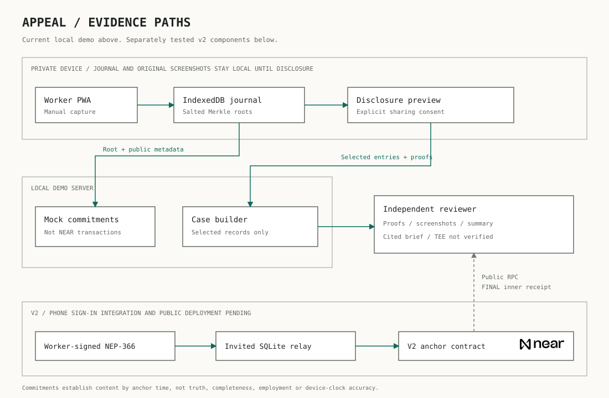
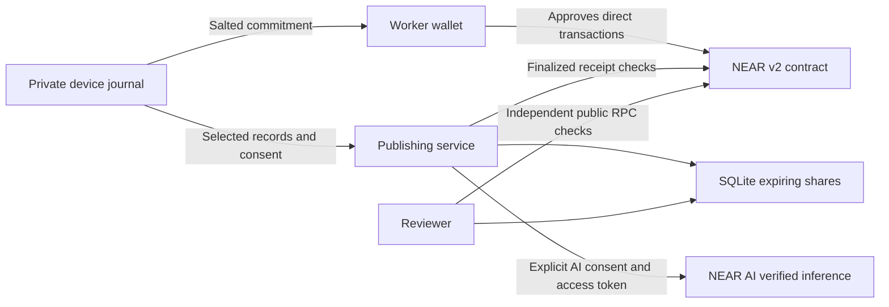

# Appeal

**Your work, on record**

Appeal keeps a private work journal on a worker's device. The worker approves NEAR commitments in their wallet, selects records to disclose, and shares an expiring evidence pack. A reviewer checks the original proofs and finalized NEAR receipts through public RPC.

The application has no simulated ledger or demo-success path. A missing deployment, rejected signature, unavailable RPC or failed AI verification is an error. The v2 contract is deployed on testnet at `kanth_s.testnet`, and `lakshmi_kanth.testnet` is registered. Deployment and registration were independently checked at finality FINAL; see [deployment evidence](docs/TESTNET-DEPLOYMENT.json). A successful worker evidence anchor, phone wallet round trip and funded private-AI run remain unobserved.

## Run

Install Node **24.22.1 or newer**. From the repository root:

```sh
npm ci
npm run build
npm test
npm start
```

Open http://localhost:8787. Without a deployed contract, the UI explicitly says **Contract deployment required**, and saving commitments is disabled. You can still connect an existing wallet and keep a private journal. It does not invent a worker identity. Existing journals from the prototype remain in their original browser database; the wallet-owned workspace uses a separate database and does not relabel old records as authenticated evidence.

Copy `.env.example` to `.env` and configure your actual deployment as described in [live setup](docs/LIVE-SETUP.md). Keys and service access tokens stay in the environment, never Git. The browser wallet handles the worker's signing keys.

## What to do and what to observe

1. Configure a deployed Appeal v2 testnet contract and have its owner register your actual worker account.
2. Click **Connect NEAR wallet** and approve the connection in Meteor Wallet using an existing testnet account. The account ID becomes the journal's worker reference. Wallet recovery uses the wallet's recovery process.
3. Record work events. Notes and original screenshot bytes remain in IndexedDB. Location is optional. Capture remains manual; automatic notification collection is not implemented.
4. Open **Journal**, click **Save all days on NEAR**, inspect the transactions and approve them in the wallet. Wallet-funded gas is explicit; direct signing does not claim gas sponsorship.
5. After the wallet returns, Appeal verifies finalized successful contract receipts against the persisted request. Only then does it mark records saved. Unknown outcomes remain pending. Transaction hashes can be supplied in any order for reconciliation without signing again; verified days are retained during partial failures.
6. Open **Prepare case**, choose records and a link lifetime, enter the publishing access token, and review the exact disclosure. Confirm sharing before publication.
7. Open the reviewer link. A successful verdict requires the configured trusted contract, the correct worker signature, successful finalized receipt, matching commitments, valid Merkle proofs, original screenshot fingerprints and a recomputed summary. Changing a disclosed record fails verification.
8. **Manage shared links** deletes hosted packs using a separate deletion capability. Links expire after the selected duration (5 minutes to 7 days; UI offers 1 hour, 24 hours or 7 days). Deletion cannot recall downloaded copies or immutable public commitments.

Public deployment evidence must be obtained through these steps. Unit-test fixtures are development inputs, never on-chain evidence or user adoption.

## Private AI

The ordinary evidence summary is a deterministic calculation, not an AI fallback. An additional private AI draft is generated only when the user explicitly opts in and supplies an AI service access token.

[NEAR AI's inference SDK](https://docs.near.ai/cloud/inference-sdk/javascript) encrypts supported request fields to the attested model, verifies gateway/model evidence and verifies the response signature. Appeal requires `UpToDate` TCB evidence and operator-approved gateway/model deployment hashes. Gateway-only signatures, malformed drafts, missing citations and failed verification are rejected. There is no unverified replacement.

Only disclosed IDs, dates, types, amounts, ratings and notes are sent. Images and location are excluded. The draft distinguishes reported observations, uncertainties and questions; its statements require human review. Arithmetic remains deterministic.

The exported AI receipt records what the server verified. **The pack verifier does not independently reverify the AI attestation**, and never awards it an attested badge. Code/model provenance review and an actual funded inference run remain release gates.

## Architecture





The optional invited-worker NEP-366 relay remains available as a separately configured backend. The worker UI currently uses direct wallet transactions. It does not claim passkey onboarding, sponsored phone signing, automatic notification capture, or support payments.

## Verification

See [observed build checks and outstanding live gates](docs/BUILD-STATUS.md).

```sh
npm test
npx playwright install chromium
npm run test:browser:portable
npm run contract:test
npm run contract:build
npm run test:live
```

`npm test` checks proof validation, adversarial RPC responses, real signature primitives, relay persistence/recovery, direct-wallet receipt validation and sharing lifecycle. Development fixtures never run in the application. Browser checks use a live-only unconfigured server and verify that missing deployment cannot become a successful anchor. They do not sign or spend.

`test:live` is different: it contacts public NEAR RPC and requires actual `ANCHOR_CONTRACT`, `WORKER_ACCOUNT_ID` and `LIVE_TX_HASH`. It exits unsuccessfully until the real integration can be verified. It never generates substitute evidence.

Independently verify a downloaded wallet-owned pack:

```sh
npm run verify -- --file /absolute/path/to/pack.json --network testnet --contract YOUR_ACTUAL_CONTRACT
```

Replace the contract argument with the independently confirmed deployment account. Add `--relayer` only when checking sponsored relay transactions.

## Hosting and data handling

Use [Dockerfile](Dockerfile) and [render.yaml](render.yaml) with an actual persistent disk. Set the exact HTTPS `PUBLIC_ORIGIN`, actual contract account and private publishing token. The server enforces JSON writes, same-origin requests, bounded bodies, rate/storage limits, security headers and share deletion capabilities. Keep `DATA_DIR` private and persistent.

`/api/config` reports configured capabilities; `/api/health` performs read-only public-chain checks. An HTTP 200 from `/api/config` is liveness, not evidence of a deployed contract.

SQLite WAL/full-sync storage persists hosted shares and management-token hashes. Expired shares are purged on startup, periodically, and during reads/writes. Backups may retain earlier disclosed data and must be protected separately. A private database snapshot can be created with `npm run shares:backup -- /absolute/private/path/shares-backup.sqlite`. Browser-held journals and exported journal backups are not encrypted by the server.

## Scope and limitations

A commitment proves integrity and authorization, not truth, employment, complete work history, device-clock accuracy, or legal entitlement. Public commitments expose account/day/count metadata. Shared notes and screenshots can contain personal information: review before sharing. AI drafts can be wrong even with a valid signature.

Remaining external verification: actual testnet deployment and worker approval, funded verified AI execution, HTTPS host checks, physical Android testing, consented worker/reviewer observations, demo video and final submission approval. No adoption, partnership, payment or prize outcome is claimed.

The dependency audit currently reports **16 low-severity findings** in upstream cryptography dependencies used by Wallet Selector and verified inference. An automatic forced downgrade was not applied. Review this dependency risk before public production operation.

## Hackathon history and license

The `prototype-baseline` tag preserves the original prototype. See the [actual baseline-to-current diff](https://github.com/Lakshmikanth-3/Appeal/compare/prototype-baseline...master) for published work; unpushed local changes are not in that diff. Commit dates are not evidence of live execution.

Privacy and Open Innovation remain proposed tracks pending the owner's decision. No specific optional integration is required by the [event rules](https://nearhackathon.com/HACKATHON.md). Publication, social posts, signing/spending and final submission follow the owner's authorization gates.

AI coding assistants contributed to the implementation: the original prototype credited Claude; subsequent development and verification used Codex. Runtime dependencies include NEAR API JS, NEAR Wallet Selector, NEAR AI's inference SDK and browser compatibility libraries. Esbuild and Playwright are development tools. The app is [MIT licensed](LICENSE); the self-hosted Bricolage Grotesque font retains its [OFL](public/fonts/OFL.txt).
