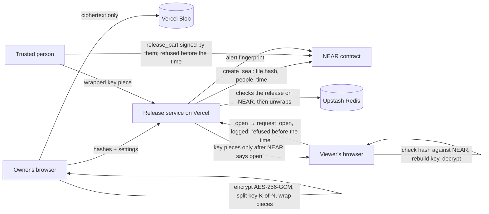

# Sealed

**Lock a file so nobody can open it before the time you choose. Not even you.**

Exam papers, results, tenders, wills, embargoed reports: pick a file and the exact second it may open. Before that time, a NEAR smart contract **blocks every attempt, records it in public, and the owner gets an alert**. Optionally, K of N trusted people must also say yes. A leaked exam paper can be traced back to its exam centre.

| | |
|---|---|
| **Live app** | **https://sealedfiles.vercel.app** |
| **Proof page** (every real transaction, clickable) | https://sealedfiles.vercel.app/proof |
| **Smart contracts** (NEAR testnet) | [`sealed.kanth_s.testnet`](https://testnet.nearblocks.io/address/sealed.kanth_s.testnet) (locks, attempts, alerts) · [`plans.sealops.kanth_s.testnet`](https://testnet.nearblocks.io/address/plans.sealops.kanth_s.testnet) (Premium payments) |
| **Tracks** | Privacy & Private AI (main) · Real-World Money · Open Innovation |
| **Tests** | 30 unit · 17 contract (10 + 7) · 3 offline browser · 3 live testnet suites (22 live checks): all passing |

**What you can do:** lock any photo, video, audio or document · send it to **one person** or **split it between N people** · unlock it **on a date and time** or **only when the parts are merged** · cancel or replace a locked file · **live private chat** between two people, like WhatsApp (end-to-end encrypted; ticks, typing and online status; photos, documents, audio, video and voice notes; messages sealed until a time; view once) · send one-time **secret links** (open at a time; only one NEAR account) · make one exam paper per centre and trace a leak · pay for **Premium with NEAR** · check any file and see every transaction on the **Proof** page.

---

## Evidence: real transactions on NEAR testnet

Every row below is a real transaction. Click it to see it on the public explorer. They come from one file locked by the live end-to-end test (`Y0nLtFX2buSq23eb`, 2 of 3 trusted people) on 14 November 2026. The "contract answered" column was read back from NEAR itself.

| Step | What happened | Contract answered | Transaction |
|---|---|---|---|
| 1 | File locked (hash, 3 trusted people, 2 needed, unlock time) | seal created | [`4tSyfouQ…CCi6d`](https://testnet.nearblocks.io/txns/4tSyfouQYNxzTefHm68LnRC15Z8XGmaQw2oYfkXCCi6d) |
| 2 | A trusted person's account funded so they can say yes | transfer | [`5QiTDAPC…wfDW`](https://testnet.nearblocks.io/txns/5QiTDAPCTtLuGSxtcBkoczft5yf9n1DzEPKPaTXfwfDW) |
| 3 | Someone tried to open it **too early** | `"early"` (blocked) | [`AazsNote…LapaSY`](https://testnet.nearblocks.io/txns/AazsNotehoFXTM6wxsoQxzUo1Ym6curTSUQdX2LapaSY) |
| 4 | Alert about that attempt recorded (fingerprint only, no personal data) | logged | [`A63PdDvR…eSChgT`](https://testnet.nearblocks.io/txns/A63PdDvR5tAMgG6E9RjC7FsMhKRAGLzxs48Lu3eSChgT) |
| 5 | Alert: a trusted person tried to say yes too early | logged | [`7QXN5DES…2dY`](https://testnet.nearblocks.io/txns/7QXN5DEssX55CjcPtx9KfBqaRuTjDAfpBr1GuTKXc2dY) |
| 6 | After the time, a trusted person said yes, signed with their own key | `"released"` | [`CT6Gkrzn…w7kdG`](https://testnet.nearblocks.io/txns/CT6GkrznipTwz4xeWj1tBtX3PQRCstHteqa2nnVw7kdG) |
| 7 | Opened after 2 of 3 said yes | `"open"` | [`4qrZWQoQ…oB8iMK`](https://testnet.nearblocks.io/txns/4qrZWQoQvdudw8UdQrttPKXRnpHSaNvDSSdBYXoB8iMK) |
| 8 | The stored file was altered: it was not opened, alert recorded | logged | [`DEQauyof…hXF3pj`](https://testnet.nearblocks.io/txns/DEQauyofi7hdNV59RH91fxbNmxAtW97V7X774jhXF3pj) |
| 9 | A real account that was not on the allow-list tried to open another file | logged | [`5sVF43Ce…Ykene`](https://testnet.nearblocks.io/txns/5sVF43CenY4oxyR6yj5nSze6z5a77MuQBaPvZH9kYene) |
| 10 | The owner cancelled a file: key destroyed, later opening refused | logged | [`H8R7Y2Hh…h9VKe`](https://testnet.nearblocks.io/txns/H8R7Y2HhGYtd7b25SWaWznDSv9CmhiQFBgfY1aah9VKe) |
| 11 | A view-once secret message was opened; its key destroyed | logged | [`EQX82xWM…XBbE1`](https://testnet.nearblocks.io/txns/EQX82xWM5tUzHNSx6ibwTJ3XPYGFiBU3g2mBrgfXBbE1) |
| 12 | Premium bought: `subscribe(1)` with exactly 1 NEAR attached | Premium active | [`ELhmFabL…DBMe`](https://testnet.nearblocks.io/txns/ELhmFabLuo7E3D8uYDx73JNK71Z2PY4ARuzkwof1DBMe) |

**Also verified on the hosted app** (https://sealedfiles.vercel.app, a browser locking a text file on Vercel; encrypted file in Vercel Blob, records in Upstash Redis):

| Step | Contract answered | Transaction |
|---|---|---|
| File locked (opens by time) | seal created | [`A9B9p8oi…wGvgKip`](https://testnet.nearblocks.io/txns/A9B9p8oidVd8AJqFotk5BiWHkaSm9NZib12K4wGvgKip) |
| Opened too early | `"early"` (blocked) | [`AXdVKjTy…55w3aLMs`](https://testnet.nearblocks.io/txns/AXdVKjTyx7BWrDCp8Ekp7BwX3P6xNmkbsbef55w3aLMs) |
| Owner alerted | logged | [`9nDT1PnC…9ZULazpS`](https://testnet.nearblocks.io/txns/9nDT1PnCYMidTuf5D7v7aRb8LzeL8vWS7FJX9ZULazpS) |
| Opened automatically at the time | `"open"` | [`9VvCvHsV…dL8csUyd`](https://testnet.nearblocks.io/txns/9VvCvHsVHRfgtjALqX8GY5BVee51t5yaxnwYdL8csUyd) |

Deployment: [contract deploy](https://testnet.nearblocks.io/txns/Dhev12vVQfyvRNyovugpNHJ3YwLQGPFPAPedrV3AMNmC) · [code upgrade](https://testnet.nearblocks.io/txns/8YRc1AFZD273JpJGWs4h8uNHfUSwoF2XBq8Ai99JqJXv) · [service account `sealops.kanth_s.testnet`](https://testnet.nearblocks.io/address/sealops.kanth_s.testnet) · [deployment record](docs/SEALED-DEPLOYMENT.json). The app's **Proof** page (`/proof`) lists new transactions as they happen.

---

## The problem

Sensitive files leak before their release time, because whoever holds the file can open it.

| Event | What went wrong |
|---|---|
| **NEET-UG 2026, India** | Exam for about 22.79 lakh students cancelled after the paper leaked on WhatsApp and Telegram ([source](https://thesouthfirst.com/health/neet-ug-2026-cancelled-after-paper-leak-row-cbi-probe-ordered-re-test-date-awaited/)) |
| **UGC-NET 2024, India** | Cancelled after reports the paper was sold online; investigators later found no evidence of a leak ([source](https://www.deccanherald.com/amp/story/india%2Fcbi-files-closure-report-in-ugc-net-paper-leak-case-3380116)) |
| **UK Budget report, 2025** | Opened about 40 minutes early by editing a URL, 24,000+ times ([source](https://rossmartin.co.uk/sme-tax-news/8818-budget-leak-bigger-than-thought-says-nscs)) |
| **US Supreme Court draft, 2022** | Leaked; nearly 100 staff questioned, leaker never found ([source](https://abajournal.com/web/article/who-leaked-dobbs-scotus-investigators-dont-know-despite-97-employee-interviews-and-forensic-sleuthing)) |

## Why NEAR

| NEAR feature | What it does here |
|---|---|
| Contract-enforced time | `release_part` and `request_open` check the block time; no admin can open early |
| Accounts and keys | Each trusted person signs with their own account (app-created, or their own NEAR wallet) |
| Permanent public log | Every attempt, **including refusals**, is stored on-chain; refusals return a status instead of failing, so they stay recorded |
| NEP-413 signed messages | "Only these accounts can open it" is proven with a wallet signature checked against an on-chain full-access key |

## Use it (about 3 minutes)

Open **https://sealedfiles.vercel.app**, or run it locally (below).

| Do this | You see |
|---|---|
| **Lock a file** → choose a PDF → **In 2 minutes** → **Some trusted people → 2 of 3 people** → **Lock my file** | "Done: your file is locked", a link to the transaction, share buttons (link, WhatsApp, email, calendar, QR, locked copy) and one private link per trusted person |
| Open the share link → **Open file** at once | **Still locked**: blocked by the contract, recorded, owner alerted |
| Open a trusted person's link → **Say yes** at once | **Too early**: blocked and recorded |
| After the countdown, **Say yes** on 2 links, then **Open file** | The file opens: "✓ Checked: this is the same file that was locked" |
| **My locked files** | Countdown, who said yes, alerts (time, device, rough location) and the public record of every attempt |
| **Check a locked file** (`/verify`) → paste the link | The record read directly from NEAR in your browser |
| **Proof** (`/proof`) | Every recent transaction with a link to the explorer |
| **Exam papers** → paste questions → 3 centres → **Make one paper per centre** → paste a leaked copy → **Find which centre** | One distinct paper per centre, a fairness check, and "Centre N, NN% confidence"; the report can be saved on NEAR |
| **My locked files** → **Replace with a new version** or **Cancel this file** | Cancelling destroys the key (nobody can ever open it) and records it on NEAR; replacing cancels the old one once the new version is locked |
| **Live chat** → your name → **Start chat** → send the invite link → chat; ⏱ seals a message until a time, ① makes it view once | Two-person chat with ✓ / ✓✓ / blue ticks, typing… and online. A sealed message shows 🔒 with a countdown to the other person and opens on time; a view-once message is deleted from the server after one view |
| **Live chat** → **Or send a one-time secret link** → write a message, add a photo → **View once** → **Send secret message** | A link that opens at the chosen time, shows the message and photo once, then says **Already opened** forever |
| **Plans** → **Connect my NEAR wallet** → **Upgrade with NEAR** | Your wallet pays the plans contract; one signature turns Premium on (more files, 100 MB, up to 20 people) |

Words in the app: **lock** = encrypt and register the time on NEAR; **trusted people** = holders of one key piece each; **say yes** = release a key piece (only after the time); **public record** = the contract's log.

## Run locally

Requires Node 22+.

```sh
npm ci
cp .env.example .env     # set SEAL_OPS_PRIVATE_KEY and SEAL_ESCROW_SECRET, or deploy your own contract (below)
npm run dev:all          # builds the browser bundles and serves http://localhost:8787
```

All network settings come from `.env`, with no built-in values: `NEAR_RPC_URLS`, `NEAR_EXPLORER_URL`, `SEAL_CONTRACT`, `SEAL_OPS_ACCOUNT`, `SEAL_HOLDER_FUNDING_NEAR`. Optional settings: `GEOIP_URL` (rough location for alerts), `RESEND_API_KEY` (email alerts), `TWILIO_*` (WhatsApp/SMS). If one isn't set, that feature is off and the app says so; nothing is faked.

## How it works



1. **Encrypt.** The browser encrypts the file (AES-256-GCM, 1 MB chunks bound to their position). The server and Blob only ever hold ciphertext. Its SHA-256 goes on-chain.
2. **Split.** In "trusted people" mode, the key is split into N Shamir pieces with threshold K using the audited `shamir-secret-sharing` library. Each piece is wrapped with a per-file key held by the release service and bound to that person's account, so people cannot pool pieces early.
3. **Lock.** The contract stores the file hash, unlock time, people, piece commitments and K.
4. **Say yes.** Each person signs `release_part` with their own key. The contract refuses it if the caller is not on the list, the time has not come, or the piece doesn't match. Every call is logged. Only after NEAR records a release does the service unwrap that piece.
5. **Open.** Each attempt is a `request_open` transaction, refused and logged before the time. After the time (and K yeses), the viewer gets the pieces, checks the file against the on-chain hash, rebuilds the key and decrypts in the browser.

**Alerts** are raised for opening too early, saying yes too early, attempts by someone not on the list, wrong key, changed file, and 5 failures in 2 minutes. Each records the time (IST and UTC), device, rough location if `GEOIP_URL` is set, and GPS only if the visitor agrees. The record stays off-chain; its SHA-256 goes on-chain.

**Exam papers** (`lib/exam.js`, runs in the browser, no AI service): one version per centre with a different question order, option order and meaning-preserving wording, but identical questions, choices and answers. A fairness check confirms equivalence. A pasted leak (partial or retyped) is matched to its centre. Measured in the unit tests on leaked copies (30–90% of a paper, retyped): 100 of 100 traced correctly for 3, 8 and 20 centres. Photographed pages (OCR) are not supported.

### Exam centres: how a real exam would use it

1. The authority keeps the original paper (and can edit it until the exam).
2. **Exam papers** makes one version per centre (same questions, different order and wording).
3. Each centre's paper is locked with **Nobody, just the time** at 09:00 and its link sent to that centre. No merging is needed: it opens by itself at 09:00.
4. Changed the paper? **Replace with a new version**: the old link is cancelled (key destroyed) and the centre gets the new link.
5. Someone tries to open it early → refused on NEAR, recorded, and the owner is told which centre's file it was (time, device, rough location).
6. A paper leaks after 09:00 (photo or retyped) → paste it into **Find which centre** → "Centre B, 86% confidence", with the report saved on NEAR.

### Plans (Free and Premium)

| | Free | Premium (1 testnet NEAR / month) |
|---|---|---|
| Locked files | 5 per day | Unlimited |
| File size | 10 MB | 100 MB |
| Trusted people | up to 3 | up to 20 |
| Secret messages, alerts, exam papers, proof | ✓ | ✓ |

Payment is `subscribe(months)` on [`plans.sealops.kanth_s.testnet`](https://testnet.nearblocks.io/address/plans.sealops.kanth_s.testnet). It requires exactly price × months, and renewals stack. The app proves the buyer's account once with a NEP-413 signature, checks `get_plan` on NEAR, and gives the browser a signed 24-hour pass. Limits are enforced by the server (`server/plans.js`) and configurable with `FREE_DAILY_LOCKS`, `FREE_MAX_FILE_MB` and `FREE_MAX_PEOPLE`. Paying with any token through NEAR Intents is mainnet-only and not built.

## What is guaranteed, and the limits

| Enforced | By |
|---|---|
| No release and no open before the time | NEAR contract (block time) |
| Only listed people, once each, with their committed piece | NEAR contract |
| Every attempt, including refusals, is public and permanent | NEAR contract log (300 entries per file; extra attempts are counted) |
| A changed file is caught before decryption | SHA-256 on NEAR, checked in the viewer's browser, plus AES-GCM authentication |
| Fewer than K pieces reveal nothing | Shamir secret sharing |
| Only allow-listed accounts can open | Release service: NEP-413 signature plus an on-chain full-access-key check |

| Limit | Detail |
|---|---|
| Collusion | The release service plus K trusted people, all together, could open early. Neither alone can. |
| Time-only files | The release service holds the key (encrypted at rest) until NEAR says open. This is escrow, not a cryptographic time-lock. |
| The owner | The person who locks the file already has the original. |
| After opening | Nothing stops a photo of the file. |
| App-created accounts | That trusted person's link holds their key; people using their own NEAR account sign in their wallet instead. |
| Network | NEAR testnet only; payments are in testnet NEAR. |
| Merge only | NEAR needs a future time, so "only when merged" locks use the earliest allowed time (about 45 seconds after locking); after that only the merged parts matter. "One person + merge" is a 2-of-2 split: the sender keeps one part, the receiver gets the other. |
| Chat files | Up to 25 MB, encrypted on the device before upload. View once deletes the message from the server; the encrypted file in storage stays but cannot be read without the chat key. |
| Live chat | Two people per chat. The key is only in the invite link, so anyone given the link before the second person joins could join instead. Updates arrive by polling every 1.5 s (Vercel has no WebSockets). "Sealed until" and view-once in chat are enforced by our server, not by NEAR; chat messages are not written to NEAR. |
| Secret links | One-way locked messages via a link. "In about 30 seconds" is the soonest, because NEAR needs a future time. |
| Cancel | Destroys our copy of the key. Someone who already downloaded and opened the file before cancelling still has it. |

## Tests

| Suite | Command | Result | Covers |
|---|---|---|---|
| Unit | `npm test` | **36 passed** | Two-person chat rules (two members only, timed messages withheld, view once deleted, receipts); stale-nonce retry across server instances; encryption round-trips (PDF, image, video, text); Shamir 2-of-2 / 3-of-5 / 5-of-7; K−1 pieces fail; tamper, reorder and truncate detection; wrapped pieces; alerts and escalation; escrow; NEP-413 (forged key, function-call key, replay, expiry); shared rate limits across instances; exam tracing (at least 18 of 20) |
| Contract | `npm run contract:test` | **10 passed** | Early refusal, non-holder, commitments, K-of-N, time-only mode, operator rules, log cap |
| Plans contract | `npm run plans:test` | **7 passed** | Exact payment extends Premium, renewals stack, expired restarts, wrong deposit refused, owner-only price and withdraw |
| Browser (offline) | `npm run test:browser` | **3 passed** | Pages and security headers, safe refusals, exam papers |
| Live chain | `npm run test:chain` | **passed** | On testnet: early yes refused, non-holder refused, early open refused, 2-of-3 unlocks |
| Live access | `npm run test:access` | **22 / 22 passed** | Account lookup, own-account holder, allow-list (no proof, forged key, unlisted account, early, allowed opens and decrypts), cancel (wrong token refused, recorded on NEAR, opening refused), Premium (Free refuses 4 people, real `subscribe()` payment, Premium confirmed, 4 people allowed) |
| Live end to end | `npm run test:e2e` | **passed (2.2 min)** | Real browser on testnet: lock a PDF 2-of-3 and a time-only text, early attempts refused with alerts, yes after the time, PDF identical to the original, time-only opens automatically, changed file → FILE TAMPERED, verify page |

| Live chat | `npm run test:chat [url]` | **17 / 17 passed** on the hosted site | Two real browsers: invite, join, a third person refused, typing and read ticks, a document decrypted byte-for-byte, a video player, view once, a message sealed until a time |
| Live demo + UI test | `npm run demo:video` | **21 / 21 passed**, 5:21 video | One recorded run on the hosted site: landing story, a time lock refused early then opened on time, a 2-of-3 merge-only lock merged and opened, the proof page, exam tracing (Centre 2, 86%), two-person chat with files, Premium active. Writes `demo/sealed-live-demo.webm` |

The live suites spend a little test NEAR from the service account.

## Repository structure

```
contract/src/lib.rs        Seal contract (Rust, near-sdk 5.30) + 10 unit tests
contract-plans/src/lib.rs  Premium plans contract (subscribe, get_plan) + 7 unit tests
lib/sealcrypto.js          Encryption, Shamir split and combine, wrapped key pieces (browser + Node)
lib/exam.js                Exam papers: per-centre versions, fairness check, leak tracing
server/index.js            Release service: routes, security headers, rate limits
server/sealChain.js        NEAR client (operator account, account lookups)
server/sealStore.js        Storage: disk locally, Vercel Blob + Upstash Redis when hosted
server/alerts.js           Alerts: record, fingerprint on-chain, email / WhatsApp
server/nearAuth.js         NEP-413 proof that a viewer owns a NEAR account
server/kv.js               Shared state for rate limits and one-time codes
server/plans.js            Free / Premium limits, Premium pass, get_plan on NEAR
server/chat.js             Two-person encrypted chat: members, messages, sealed-until, view once, receipts
client/                    Browser bundles: crypto + QR (sealed.js), Meteor Wallet (wallet.js)
public/                    Pages: landing, app (lock, my files, exam papers, live chat, plans), chat, open, trusted person, check, proof
api/index.js               Vercel entry (same handler as local)
scripts/                   Contract deploy and upgrade, plans deploy, extra operator keys, live testnet checks
tests/                     Unit tests and Playwright browser suites
docs/SEALED-DEPLOYMENT.json  Deployment and upgrade transactions
```

## Deploy your own

```sh
npm run contract:test && npm run contract:build
CONTRACT_OWNER=<you>.testnet npm run contract:deploy               # prints the plan
CONTRACT_OWNER=<you>.testnet npm run contract:deploy -- --broadcast  # creates sealed.<you> and sealops.<you>
```

**Vercel.** `vercel.json` sends every route through one function, so the security headers apply everywhere. Connect a **Blob** store (the browser uploads ciphertext directly) and **Upstash Redis** (records, alerts, rate limits, one-time codes). Then add the `.env` values as environment variables. Until both are connected, the hosted site refuses to lock files instead of losing them.

## Libraries

near-sdk 5.30 (Rust) · near-api-js 7.2 · shamir-secret-sharing 0.0.4 (audited by Cure53 and Zellic) · @near-wallet-selector/core and meteor-wallet 10.1.4 · @vercel/blob 2.9 · qrcode-generator 1.4.4 · buffer, process, util (browser shims) · esbuild and Playwright (development) · WebCrypto (built in).

## Status

- Live at https://sealedfiles.vercel.app. Locking, sharing, early refusal, automatic opening, cancel, live chat, secret links, Premium and the Proof page all work on the hosted copy.
- Both contracts deployed on NEAR testnet; all unit, contract, browser and live testnet suites pass.
- Not built: exam leak tracing from photos (OCR), AI features, mainnet, payment with other tokens.

## AI assistance and licence

Built during the NEAR hackathon window, on 14 November 2026. Earlier commits in this repository belong to an abandoned idea and are not part of this submission. Most code was written with an AI coding assistant (Claude Code) under the author's direction; the author chose the product, the trust model and every deployment. MIT licence. Not legal or exam-board advice.
