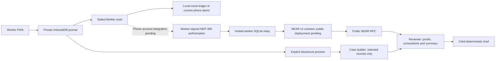

# Appeal

**Your work, on record**

A private work journal with selective evidence sharing. The current local demo uses a mock ledger; worker-owned NEAR anchoring is under implementation. The intended flow lets a lawyer or union inspect disclosed records against successful NEAR commitments.

## Try the working prototype

Requires Node **22.21.0 or newer**. No wallet, API key, `.env`, Rust toolchain or NEAR funds are needed for the local demo.

```sh
npm ci
npm test
npm run start:demo
```

Open **http://localhost:8790**. This command forces mock mode, disables relay spending and uses a fresh temporary ledger. Stop it with Ctrl+C. Its temporary ledger is not recovered on a new run; use a fresh browser profile for a new demo session so it does not reuse an old demo journal. It does not clear or migrate any existing browser journal. The normal `npm start` command uses the configured application at port 8787 instead.

### Judge walkthrough: do this, observe that

| Action | Expected result |
|---|---|
| Record two entries with notes beginning `SYNTHETIC`; optionally attach a non-identifying PNG/JPEG/WebP. Leave location off. | Journal shows two records. Reload retains them. The network badge says **Mock chain (demo)**. |
| Open **Journal**, then **Save all days to demo ledger**. | A day receives a local mock commitment; no public NEAR transaction is claimed. |
| Open **Prepare case**, expand a saved day, untick one entry and click **Review selected records**. | Preview lists only the selected records, screenshot count and included locations. Nothing is published yet. |
| Click **Create reviewer link** before confirming consent. | The app refuses to publish. Confirm sharing, then create the link. |
| Open the reviewer link. | **Demo verified** appears; one of two records is disclosed. Summary and cited review brief use disclosed entries only. The page explicitly says TEE attestation is not verified. |
| Download the JSON pack, edit a disclosed amount, and load that copy in the reviewer file input. | **Not verified** appears and the review brief is hidden. |
| Download a backup in **Backup**; open a fresh browser profile and restore it on the same demo server. | Local validation runs before writing; original screenshot bytes and records return. Imported anchor references say **restored; not rechecked**. A nonempty journal refuses restore. |

The automated browser suite exercises these behaviors with synthetic fixtures and separate temporary state. A Chromium download removes the dependency on a preinstalled Chrome browser:

```sh
npx playwright install chromium
npm run test:browser:portable
```

On a supported Linux host missing browser libraries, use `npx playwright install --with-deps chromium` with the required host permissions. `npm run test:browser` uses installed Chrome on the development PC. The test server runs on port 18987. Browser requirements follow [Playwright's installation guide](https://playwright.dev/docs/browsers).

Observed on Windows with Node 22.21.0: **139 Node tests**, **four original demo checks** and **ten Chrome browser scenarios** passed. Rust v2 has a separate build/export record and 12 SDK host tests; see [contract verification](contract/BUILD-VERIFICATION.md). These results are local tests, not testnet deployment or real-user measurements. No public contract, transaction, hosted URL or public X demo is claimed yet.

A fresh source snapshot without installed packages, credentials or runtime data also passed `npm ci`, the full Node/demo suite and all ten portable Chromium scenarios. The public-repository clean-clone check remains pending publication.

### Proposed track evidence

| Track | Product fit | Inspectable implementation | Release evidence still needed |
|---|---|---|---|
| Privacy & Private AI (`privacy`, working choice) | Undisclosed records remain local; selected records prove membership in a salted commitment | [Merkle proofs](lib/merkle.js), [disclosure preview](public/app.js), [independent verifier](lib/verify.js), [worker-owned v2 contract](contract/src/lib.rs) | Actual successful worker-authorized NEAR execution. No private AI inference or verified TEE attestation is claimed. |
| Open Innovation (`open`, candidate) | Portable, selectively disclosed evidence for a worker/reviewer workflow | [Cited review brief](lib/brief.js), [backup validation](lib/backup.js), [originality and pilot evidence](docs/JUDGING-EVIDENCE.md) | Final track choice by the owner and actual worker/reviewer observations |

Track hints are not mandatory integrations under [event rule Q-011](https://nearhackathon.com/HACKATHON.md). Track selection has not been submitted. All project claims are scoped to the behavior shown above and the separately tested v2 components below.


## Implementation status

See [IMPLEMENTATION-PLAN.md](IMPLEMENTATION-PLAN.md) for phases, exit checks and pending access. This is an actively developed prototype, not yet a deployed worker-owned service.

- Capture, reload, offline capture/reconnect, all six event types, selective disclosure and screenshot verification have automated Chrome coverage at a phone-sized viewport. Tests use isolated mock data, not real rider records.
- The worker workspace separates Record, Journal, Prepare case and Backup. Publishing requires a final disclosure preview and consent. Backups restore atomically into an empty journal after local hash/root validation; existing records are never overwritten. Backups are unencrypted private files.
- Verified packs provide a deterministic review brief with entry citations, proof limits, a canonical pack fingerprint and text/print export. It is not an attested AI or legal conclusion.
- See [the five-area evidence framework](docs/JUDGING-EVIDENCE.md) for originality sources, an actual-user pilot protocol and a source-required operating-cost calculator. Impact, buyer demand and real cloud/chain results remain unmeasured.
- `npm test` runs adversarial evidence checks and the synthetic demo. `npm run test:browser` runs the installed Chrome browser tests. Test ledgers and sample packs use temporary directories.
- The current phone flow uses self-reported v1 IDs. V2 packs can verify NEAR account authorization through successful delegated execution; personal names, capture times, truth and completeness remain unverified claims.
- TEE attestation is not implemented. A pack claiming an attestation kind is never treated as verified attestation by the current verifier.
- The optional invited-worker relay persists jobs and quota reservations in SQLite, saves signed transactions before broadcast and reconciles uncertain results. It is disabled by default and testnet-only. See [relay setup and recovery](docs/RELAY-OPERATIONS.md).
- Testnet deployment, phone account/signature integration, production sharing controls and real rider validation remain unfinished. Do not expose the current server as a public production service.
- The owner confirmed NEAR HACKATHON. Eligibility, deadline and publication gates are recorded in [EVENT-REQUIREMENTS.md](EVENT-REQUIREMENTS.md). Pilot usage has not been measured; test fixtures are not impact metrics.

## Run it

```bash
npm ci             # Node 22.21+; built-in SQLite is experimental on the tested runtime
npm start          # worker app http://localhost:8787 · verifier http://localhost:8787/verify
npm test           # sample log -> anchors -> evidence pack -> verifier passes, then fails on 3 kinds of tampering
```

It runs on a local **mock chain** by default. `npm run demo` currently refuses live networks while worker-signed v2 anchoring is integrated. The HTTP server also refuses unsigned live anchor requests. Adding a relayer key alone does not enable production anchoring. Keep any future credentials in `.env`, never chat or Git.

The account-bound Rust contract and signature validation are described in [docs/OWNERSHIP-PROTOCOL.md](docs/OWNERSHIP-PROTOCOL.md). See [contract/README.md](contract/README.md) for build and test commands. Successful compilation does not mean the contract has been deployed or the passkey flow is complete.

**Phones need HTTPS.** Browsers only allow the crypto, camera and location APIs on `https://` or `localhost`. To use the app on a rider's phone, expose the server through an HTTPS tunnel (for example `cloudflared tunnel --url http://localhost:8787`) or deploy it.

## How it works

1. **Capture (worker app, PWA).** The worker taps the type of event (trip, pay, rating, penalty, notification, deactivation), adds an amount, the notification text and an optional screenshot, and taps *Capture now*. The time comes from that tap. Location is optional. Entries and screenshots stay in the phone's IndexedDB storage; the SHA-256 hash of the original screenshot bytes is stored in its entry (PNG, JPEG or WebP; up to 8 MB).
2. **Daily anchor.** Each day's entries become a Merkle tree. Every entry has a random salt to hide guessable entry values; worker ID, day and count are public anchor metadata. The demo records the commitment on a mock ledger. Worker authorization and sponsored NEAR execution are being integrated.
3. **Build my case.** The worker picks days and entries. Each disclosed entry is sent with its Merkle proof; undisclosed entries never leave the phone. The case-builder (`server/caseAgent.js`) checks the proofs and produces a deterministic summary (earnings, rating trend, penalties, deactivation notice).
4. **Verify.** `/verify?id=…` needs no login. Mock packs use the local ledger. Live v1 packs verify content commitments through public NEAR RPC. V2 also follows worker-authorized delegate receipts and requires successful inner contract execution. Both recompute the summary; the phone's v2 sign-in/relay path remains unfinished.

## What it proves, and what it does not

- ✅ Each disclosed record matches content committed by its anchor time; capture time is self-reported.
- ✅ The summary was computed only from the disclosed records.
- ❌ It does **not** prove that a record is true. A worker could type in a false entry before anchoring. "Captured live" means the timestamp was taken when the entry was saved in the app, not that the app read it from the platform.
- ❌ The summary is **not TEE-attested yet**. NEAR AI Cloud attestation is stubbed (`attestation.kind = "unattested-local"`) and the verifier says so.
- The current phone flow uses random v1 worker IDs. The v2 relay requires a worker-owned NEAR account signature; passkey onboarding and phone integration remain unfinished.
- The mock ledger demonstrates the checks; it supplies no independent chain timestamp.
- Live anchors require a deployed `ANCHOR_CONTRACT` and successful finalized execution. The verifier checks network, transaction hash, relayer, contract, method and count. Legacy packs backed by failed calls are rejected.

Evidence support, not legal advice.

## Not built yet (from the PRD)

- FastAuth / passkey worker accounts
- NEAR AI Cloud TEE attestation
- Intents support payouts
- Automatic Android notification capture (the PWA uses guided manual and screenshot capture)

## Layout

| Path | What |
|---|---|
| `lib/merkle.js` | Canonical JSON, salted Merkle tree, proofs (browser + Node) |
| `lib/summary.js` | Deterministic case summary |
| `lib/verify.js` | Evidence-pack verification |
| `lib/nearRpc.js` | Reads anchor transactions from NEAR RPC |
| `server/` | HTTP server, relayer and mock chain, case builder |
| `public/` | Worker PWA and verifier page |
| `contract/src/lib.rs` | Account-bound v2 Rust contract under integration |
| `contract/anchor.js` | Legacy v1 prototype source; do not deploy for v2 |
| `scripts/demo.js` | End-to-end demo and tamper tests |

## Libraries and AI use

- `near-api-js` 7.2.0 (signing relayer transactions). No other runtime dependencies; uses Web Crypto and IndexedDB.
- AI assistants contributed to the implementation: the original README credited Claude; subsequent implementation and automated validation used Codex. Automated results and unfinished work are recorded in the implementation plan.
- Playwright is development-only browser automation. Bricolage Grotesque is self-hosted under its [SIL Open Font License](public/fonts/OFL.txt). The application source is [MIT licensed](LICENSE); third-party licenses remain their own.

## Architecture and trust boundaries

The running phone demo and the separately tested v2 relay are distinct paths. The dashed connection below is pending phone-account integration, not a completed live flow.


The NEAR wordmark is the unmodified [official documentation asset](https://github.com/near/docs/blob/master/assets/logo.svg), retained in [public/brands/near.svg](public/brands/near.svg) for identification. Its display does not imply endorsement or a deployed contract.



The sponsor can pay for an allowed worker-signed call but cannot change the committed worker/root arguments. The relayer persists the sponsor signature before broadcast and blocks new signing on an unknown result. [The v2 verifier](lib/nearRpc.js) checks finalized **inner contract receipt** success, not merely successful outer delegation. The standalone CLI reads public RPC without the case server or `.env`. A selected screenshot's original bytes must match its entry hash; redacting those bytes would create different evidence. A worker may omit screenshots before sharing instead.

Hosted case links currently grant read access to anyone who knows the link, with no expiry/revocation. The app explains this before publishing. Local browser storage and exported backups are not claimed encrypted. Chain commitments do not establish truth, completeness, a personal name or the accuracy of a phone clock.

## Hackathon provenance and release

The project began from an existing local prototype. Its exact original creation date is unverified; it is not represented as newly written in the eligibility window. Work added during this session includes evidence/schema hardening, original-byte screenshots, v2 Rust ownership controls, strict finalized receipt verification, the durable budgeted relay, the new workspace/disclosure/restore flows and cited review briefs. The staged original snapshot and subsequent working changes are not yet published as Git commits. Actual timestamps will be preserved; no retrospective commit dates or fabricated tags are used. A reviewable baseline-to-submission diff must be linked after an authorized publication.

The event accepts eligible development since **19 October 2026** and ends **14 November 2026, 23:59 UTC**. A local-only demo needs a public video post when judges cannot open it; the owner must publish it with **@NEARProtocol** and **#NEARHackathon**. [Submission preparation](docs/SUBMISSION-PREPARATION.md) keeps pending owner decisions separate from public claims. No application has been sent.

## Independent NEAR verification

Download the pack and use `npm run verify -- --help` for CLI options. Supply the actual file path, network, contract and relayer confirmed through a trusted source. The CLI reads public NEAR RPC directly, does not call this application server, does not load `.env`, and refuses mock evidence. A failed check exits with status 1.

The browser's **Trusted NEAR deployment** controls follow the same rule: a pack cannot choose its own trusted contract or relayer. On a configured deployment these controls start from the site's configuration; confirm them independently for stronger assurance. This remains RPC-based verification, not a NEAR light client.

Phase 2 is in progress. V2 pack verification and the persistent invited-worker relay are tested locally, including forced process restart and exact-byte transaction replay. No public-chain deployment or completed passkey onboarding is claimed. A green v2 account verdict does not prove a personal name, employment, record truth or TEE execution. Actual testnet/disk/phone checks and the remaining account flow are required before release.

The read-only server can use public `NEAR_ACCOUNT_ID`/`ANCHOR_CONTRACT` configuration without `NEAR_PRIVATE_KEY`. The CLI does not load `.env`. Signing keys are only needed for authorized transaction submission; the public config endpoint omits private RPC URLs.
