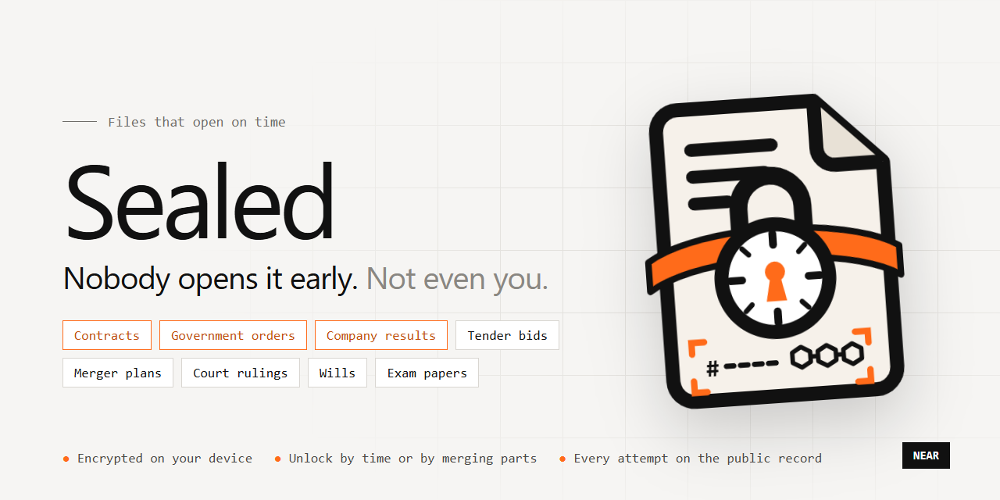
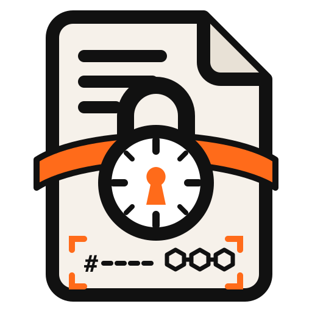
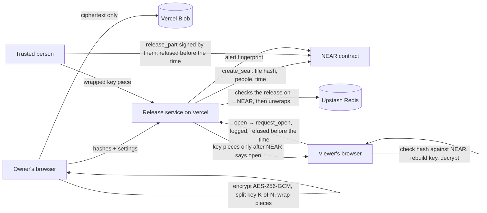
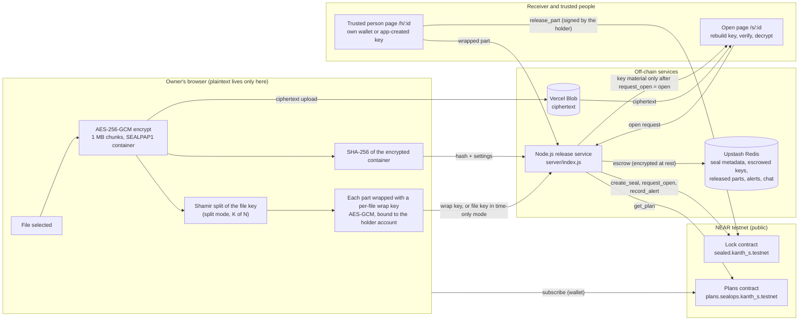
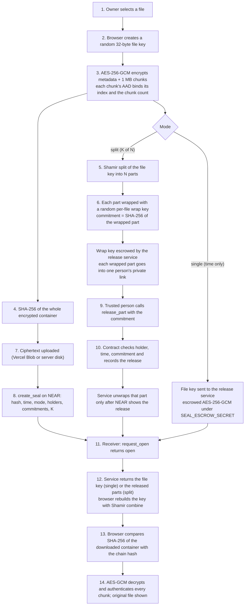
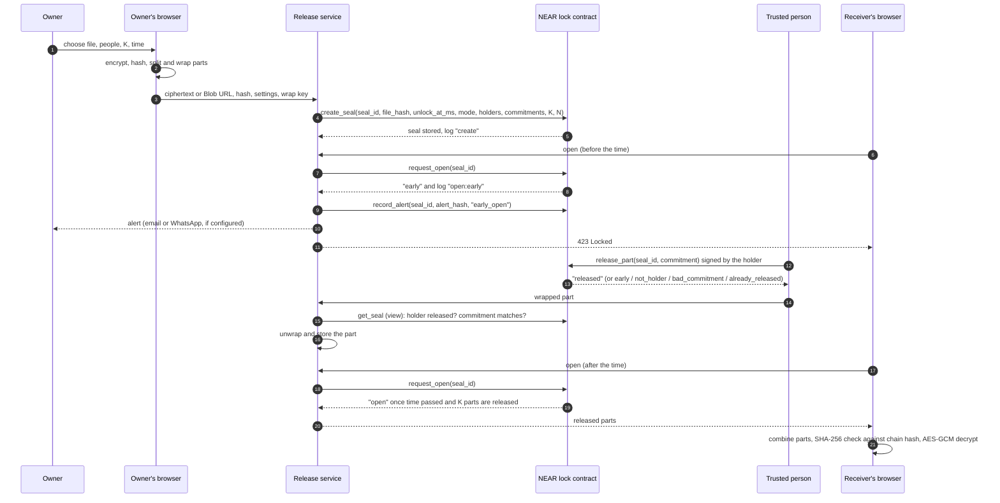
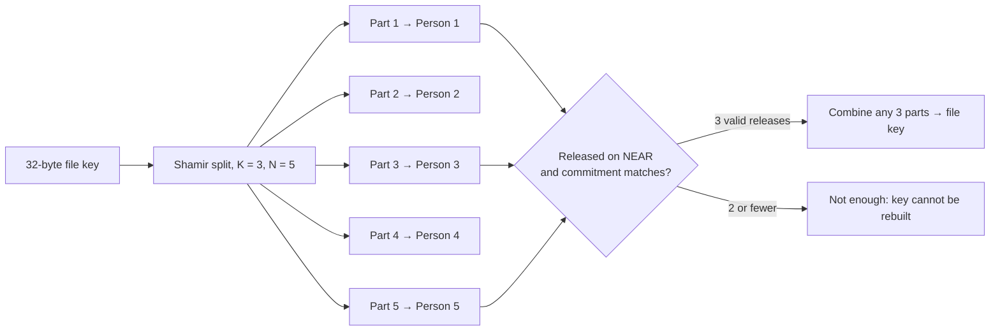
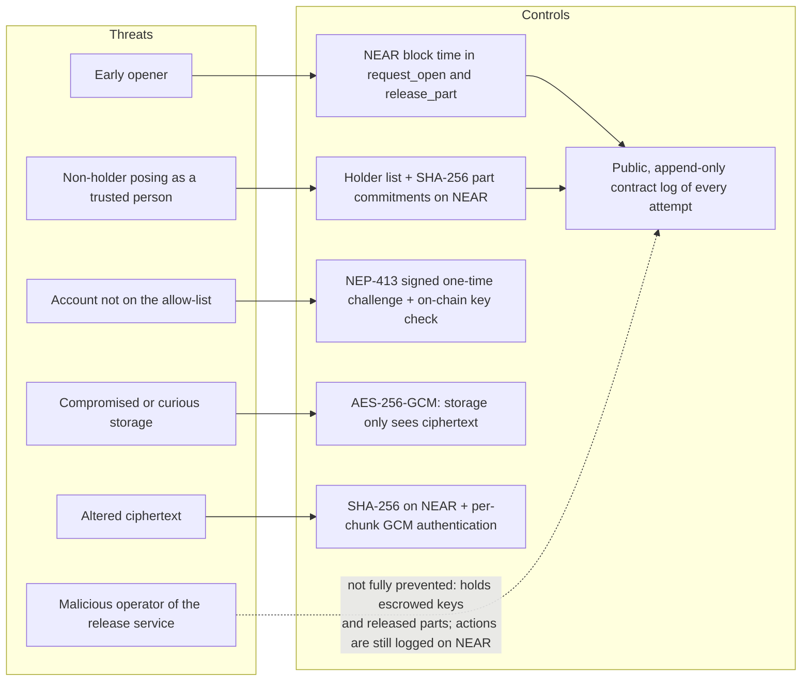
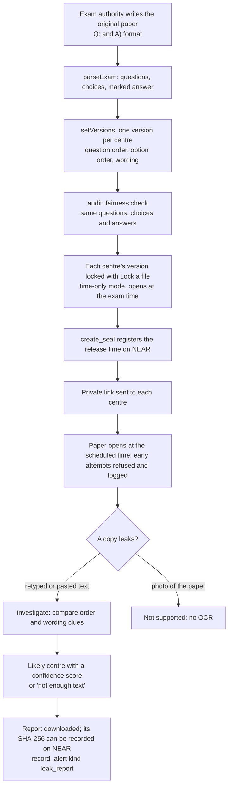
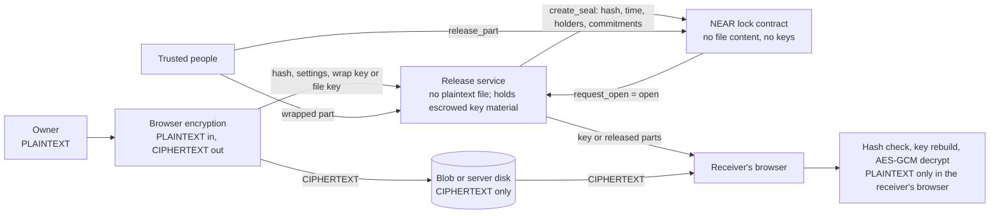

<p align="center"></p>

#  Sealed

**Lock a file so nobody can open it before the time you choose. Not even you.**

Contracts, government orders, company results, tender bids, merger plans, court rulings, wills, exam papers: pick any document and the exact second it may open, or require that enough people merge their key parts. Before that, a NEAR smart contract **blocks every attempt, records it in public, and the owner gets an alert**. Two people can also chat privately, end-to-end encrypted, with messages sealed until a time or seen only once.

| | |
|---|---|
| **Live app** | **https://sealedfiles.vercel.app** |
| **Proof page** (every real transaction, clickable) | https://sealedfiles.vercel.app/proof |
| **Smart contracts** (NEAR testnet) | [`sealed.kanth_s.testnet`](https://testnet.nearblocks.io/address/sealed.kanth_s.testnet) (locks, attempts, alerts) · [`plans.sealops.kanth_s.testnet`](https://testnet.nearblocks.io/address/plans.sealops.kanth_s.testnet) (Premium payments) |
| **Tracks** | Privacy & Private AI (main) · Real-World Money · Open Innovation |
| **Who it is for** | Companies (results, merger plans, board papers), governments (orders, budgets, tenders), legal teams (contracts, rulings), families (wills), schools (exam papers) |
| **Tests** | 36 unit · 18 contract (10 + 8) · 3 offline browser · live testnet suites (22 access checks, end to end, 17 chat checks): all passing |

**What you can do:** lock any photo, video, audio or document · send it to **one person** or **split it between N people** · unlock it **on a date and time** or **only when the parts are merged** · cancel or replace a locked file · **live private chat** between two people, like WhatsApp (end-to-end encrypted; ticks, typing and online status; photos, documents, audio, video and voice notes; messages sealed until a time; view once) · send one-time **secret links** (open at a time; only one NEAR account) · make one exam paper per centre and trace a leak · pay for **Premium with NEAR** · check any file and see every transaction on the **Proof** page.

---

## Evidence: real transactions on NEAR testnet

Every row below is a real transaction. Click it to see it on the public explorer. They come from one file locked by the live end-to-end test (`Y0nLtFX2buSq23eb`, 2 of 3 trusted people) on 14 November 2026. The "contract answered" column was read back from NEAR itself.

| Step | What happened | Contract answered | Transaction |
|---|---|---|---|
| 1 | File locked (hash, 3 trusted people, 2 needed, unlock time) | seal created | [`4tSyfouQ…CCi6d`](https://testnet.nearblocks.io/txns/4tSyfouQYNxzTefHm68LnRC15Z8XGmaQw2oYfkXCCi6d) |
| 2 | A trusted person's account funded so they can say yes | transfer | [`5QiTDAPC…wfDW`](https://testnet.nearblocks.io/txns/5QiTDAPCTtLuGSxtcBkoczft5yf9n1DzEPKPaTXfwfDW) |
| 3 | Someone tried to open it **too early** | `"early"` (blocked) | [`AazsNote…LapaSY`](https://testnet.nearblocks.io/txns/AazsNotehoFXTM6wxsoQxzUo1Ym6curTSUQdX2LapaSY) |
| 4 | Alert about that attempt recorded (fingerprint only, no personal data) | logged | [`A63PdDvR…eSChgT`](https://testnet.nearblocks.io/txns/A63PdDvR5tAMgG6E9RjC7FsMhKRAGLzxs48Lu3eSChgT) |
| 5 | Alert: a trusted person tried to say yes too early | logged | [`7QXN5DES…2dY`](https://testnet.nearblocks.io/txns/7QXN5DEssX55CjcPtx9KfBqaRuTjDAfpBr1GuTKXc2dY) |
| 6 | After the time, a trusted person said yes, signed with their own key | `"released"` | [`CT6Gkrzn…w7kdG`](https://testnet.nearblocks.io/txns/CT6GkrznipTwz4xeWj1tBtX3PQRCstHteqa2nnVw7kdG) |
| 7 | Opened after 2 of 3 said yes | `"open"` | [`4qrZWQoQ…oB8iMK`](https://testnet.nearblocks.io/txns/4qrZWQoQvdudw8UdQrttPKXRnpHSaNvDSSdBYXoB8iMK) |
| 8 | The stored file was altered: it was not opened, alert recorded | logged | [`DEQauyof…hXF3pj`](https://testnet.nearblocks.io/txns/DEQauyofi7hdNV59RH91fxbNmxAtW97V7X774jhXF3pj) |
| 9 | A real account that was not on the allow-list tried to open another file | logged | [`5sVF43Ce…Ykene`](https://testnet.nearblocks.io/txns/5sVF43CenY4oxyR6yj5nSze6z5a77MuQBaPvZH9kYene) |
| 10 | The owner cancelled a file: key destroyed, later opening refused | logged | [`H8R7Y2Hh…h9VKe`](https://testnet.nearblocks.io/txns/H8R7Y2HhGYtd7b25SWaWznDSv9CmhiQFBgfY1aah9VKe) |
| 11 | A view-once secret message was opened; its key destroyed | logged | [`EQX82xWM…XBbE1`](https://testnet.nearblocks.io/txns/EQX82xWM5tUzHNSx6ibwTJ3XPYGFiBU3g2mBrgfXBbE1) |
| 12 | Premium bought: `subscribe(1)` with exactly 1 NEAR attached | Premium active | [`ELhmFabL…DBMe`](https://testnet.nearblocks.io/txns/ELhmFabLuo7E3D8uYDx73JNK71Z2PY4ARuzkwof1DBMe) |

**Also verified on the hosted app** (https://sealedfiles.vercel.app, a browser locking a text file on Vercel; encrypted file in Vercel Blob, records in Upstash Redis):

| Step | Contract answered | Transaction |
|---|---|---|
| File locked (opens by time) | seal created | [`A9B9p8oi…wGvgKip`](https://testnet.nearblocks.io/txns/A9B9p8oidVd8AJqFotk5BiWHkaSm9NZib12K4wGvgKip) |
| Opened too early | `"early"` (blocked) | [`AXdVKjTy…55w3aLMs`](https://testnet.nearblocks.io/txns/AXdVKjTyx7BWrDCp8Ekp7BwX3P6xNmkbsbef55w3aLMs) |
| Owner alerted | logged | [`9nDT1PnC…9ZULazpS`](https://testnet.nearblocks.io/txns/9nDT1PnCYMidTuf5D7v7aRb8LzeL8vWS7FJX9ZULazpS) |
| Opened automatically at the time | `"open"` | [`9VvCvHsV…dL8csUyd`](https://testnet.nearblocks.io/txns/9VvCvHsVHRfgtjALqX8GY5BVee51t5yaxnwYdL8csUyd) |

Deployment: [contract deploy](https://testnet.nearblocks.io/txns/Dhev12vVQfyvRNyovugpNHJ3YwLQGPFPAPedrV3AMNmC) · [code upgrade](https://testnet.nearblocks.io/txns/8YRc1AFZD273JpJGWs4h8uNHfUSwoF2XBq8Ai99JqJXv) · [service account `sealops.kanth_s.testnet`](https://testnet.nearblocks.io/address/sealops.kanth_s.testnet) · [deployment record](docs/SEALED-DEPLOYMENT.json). The app's **Proof** page (`/proof`) lists new transactions as they happen.

---

## The problem

Sensitive files leak before their release time, because whoever holds the file can open it.

| Event | What went wrong |
|---|---|
| **NEET-UG 2026, India** | Exam for about 22.79 lakh students cancelled after the paper leaked on WhatsApp and Telegram ([source](https://thesouthfirst.com/health/neet-ug-2026-cancelled-after-paper-leak-row-cbi-probe-ordered-re-test-date-awaited/)) |
| **UGC-NET 2024, India** | Cancelled after reports the paper was sold online; investigators later found no evidence of a leak ([source](https://www.deccanherald.com/amp/story/india%2Fcbi-files-closure-report-in-ugc-net-paper-leak-case-3380116)) |
| **UK Budget report, 2025** | Opened about 40 minutes early by editing a URL, 24,000+ times ([source](https://rossmartin.co.uk/sme-tax-news/8818-budget-leak-bigger-than-thought-says-nscs)) |
| **US Supreme Court draft, 2022** | Leaked; nearly 100 staff questioned, leaker never found ([source](https://abajournal.com/web/article/who-leaked-dobbs-scotus-investigators-dont-know-despite-97-employee-interviews-and-forensic-sleuthing)) |

## Why NEAR

| NEAR feature | What it does here |
|---|---|
| Contract-enforced time | `release_part` and `request_open` check the block time; no admin can open early |
| Accounts and keys | Each trusted person signs with their own account (app-created, or their own NEAR wallet) |
| Permanent public log | Every attempt, **including refusals**, is stored on-chain; refusals return a status instead of failing, so they stay recorded |
| NEP-413 signed messages | "Only these accounts can open it" is proven with a wallet signature checked against an on-chain full-access key |

## Use it (about 3 minutes)

Open **https://sealedfiles.vercel.app**, or run it locally (below).

| Do this | You see |
|---|---|
| **Lock a file** → choose a PDF → **In 2 minutes** → **Some trusted people → 2 of 3 people** → **Lock my file** | "Done: your file is locked", a link to the transaction, share buttons (link, WhatsApp, email, calendar, QR, locked copy) and one private link per trusted person |
| Open the share link → **Open file** at once | **Still locked**: blocked by the contract, recorded, owner alerted |
| Open a trusted person's link → **Say yes** at once | **Too early**: blocked and recorded |
| After the countdown, **Say yes** on 2 links, then **Open file** | The file opens: "✓ Checked: this is the same file that was locked" |
| **My locked files** | Countdown, who said yes, alerts (time, device, rough location) and the public record of every attempt |
| **Check a locked file** (`/verify`) → paste the link | The record read directly from NEAR in your browser |
| **Proof** (`/proof`) | Every recent transaction with a link to the explorer |
| **Exam papers** → paste questions → 3 centres → **Make one paper per centre** → paste a leaked copy → **Find which centre** | One distinct paper per centre, a fairness check, and "Centre N, NN% confidence"; the report can be saved on NEAR |
| **My locked files** → **Replace with a new version** or **Cancel this file** | Cancelling destroys the key (nobody can ever open it) and records it on NEAR; replacing cancels the old one once the new version is locked |
| **Live chat** → your name → **Start chat** → send the invite link → chat; ⏱ seals a message until a time, ① makes it view once | Two-person chat with ✓ / ✓✓ / blue ticks, typing… and online. A sealed message shows 🔒 with a countdown to the other person and opens on time; a view-once message is deleted from the server after one view |
| **Live chat** → **Or send a one-time secret link** → write a message, add a photo → **View once** → **Send secret message** | A link that opens at the chosen time, shows the message and photo once, then says **Already opened** forever |
| **Plans** → **Connect my NEAR wallet** → **Upgrade with NEAR** | Your wallet pays the plans contract; one signature turns Premium on (more files, 100 MB, up to 20 people) |

Words in the app: **lock** = encrypt and register the time on NEAR; **trusted people** = holders of one key piece each; **say yes** = release a key piece (only after the time); **public record** = the contract's log.

## Run locally

Requires Node 22+.

```sh
npm ci
cp .env.example .env     # set SEAL_OPS_PRIVATE_KEY and SEAL_ESCROW_SECRET, or deploy your own contract (below)
npm run dev:all          # builds the browser bundles and serves http://localhost:8787
```

All network settings come from `.env`, with no built-in values: `NEAR_RPC_URLS`, `NEAR_EXPLORER_URL`, `SEAL_CONTRACT`, `SEAL_OPS_ACCOUNT`, `SEAL_HOLDER_FUNDING_NEAR`. Optional settings: `GEOIP_URL` (rough location for alerts), `RESEND_API_KEY` (email alerts), `TWILIO_*` (WhatsApp/SMS). If one isn't set, that feature is off and the app says so; nothing is faked.

## How it works



1. **Encrypt.** The browser encrypts the file (AES-256-GCM, 1 MB chunks bound to their position). The server and Blob only ever hold ciphertext. Its SHA-256 goes on-chain.
2. **Split.** In "trusted people" mode, the key is split into N Shamir pieces with threshold K using the audited `shamir-secret-sharing` library. Each piece is wrapped with a per-file key held by the release service and bound to that person's account, so people cannot pool pieces early.
3. **Lock.** The contract stores the file hash, unlock time, people, piece commitments and K.
4. **Say yes.** Each person signs `release_part` with their own key. The contract refuses it if the caller is not on the list, the time has not come, or the piece doesn't match. Every call is logged. Only after NEAR records a release does the service unwrap that piece.
5. **Open.** Each attempt is a `request_open` transaction, refused and logged before the time. After the time (and K yeses), the viewer gets the pieces, checks the file against the on-chain hash, rebuilds the key and decrypts in the browser.

**Alerts** are raised for opening too early, saying yes too early, attempts by someone not on the list, wrong key, changed file, and 5 failures in 2 minutes. Each records the time (IST and UTC), device, rough location if `GEOIP_URL` is set, and GPS only if the visitor agrees. The record stays off-chain; its SHA-256 goes on-chain.

**Exam papers** (`lib/exam.js`, runs in the browser, no AI service): one version per centre with a different question order, option order and meaning-preserving wording, but identical questions, choices and answers. A fairness check confirms equivalence. A pasted leak (partial or retyped) is matched to its centre. Measured in the unit tests on leaked copies (30–90% of a paper, retyped): 100 of 100 traced correctly for 3, 8 and 20 centres. Photographed pages (OCR) are not supported.

### Exam centres: how a real exam would use it

1. The authority keeps the original paper (and can edit it until the exam).
2. **Exam papers** makes one version per centre (same questions, different order and wording).
3. Each centre's paper is locked with **Nobody, just the time** at 09:00 and its link sent to that centre. No merging is needed: it opens by itself at 09:00.
4. Changed the paper? **Replace with a new version**: the old link is cancelled (key destroyed) and the centre gets the new link.
5. Someone tries to open it early → refused on NEAR, recorded, and the owner is told which centre's file it was (time, device, rough location).
6. A paper leaks after 09:00 (photo or retyped) → paste it into **Find which centre** → "Centre B, 86% confidence", with the report saved on NEAR.

### Plans (Free and Premium)

| | Free | Premium (10 testnet NEAR / month) |
|---|---|---|
| Locked files | 5 per day | Unlimited |
| File size | 10 MB | 100 MB |
| Trusted people | up to 3 | up to 20 |
| Secret messages, alerts, exam papers, proof | ✓ | ✓ |

Payment is `subscribe(months)` on [`plans.sealops.kanth_s.testnet`](https://testnet.nearblocks.io/address/plans.sealops.kanth_s.testnet). It requires exactly price × months, and renewals stack. The price is stored on the contract and only the owner can change it (`npm run plans:price -- 10 --broadcast`); the app always shows the contract's current price. The app proves the buyer's account once with a NEP-413 signature, checks `get_plan` on NEAR, and gives the browser a signed 24-hour pass. Limits are enforced by the server (`server/plans.js`) and configurable with `FREE_DAILY_LOCKS`, `FREE_MAX_FILE_MB` and `FREE_MAX_PEOPLE`. Paying with any token through NEAR Intents is mainnet-only and not built.

## What is guaranteed, and the limits

| Enforced | By |
|---|---|
| No release and no open before the time | NEAR contract (block time) |
| Only listed people, once each, with their committed piece | NEAR contract |
| Every attempt, including refusals, is public and permanent | NEAR contract log (300 entries per file; extra attempts are counted) |
| A changed file is caught before decryption | SHA-256 on NEAR, checked in the viewer's browser, plus AES-GCM authentication |
| Fewer than K pieces reveal nothing | Shamir secret sharing |
| Only allow-listed accounts can open | Release service: NEP-413 signature plus an on-chain full-access-key check |

| Limit | Detail |
|---|---|
| Collusion | The release service plus K trusted people, all together, could open early. Neither alone can. |
| Time-only files | The release service holds the key (encrypted at rest) until NEAR says open. This is escrow, not a cryptographic time-lock. |
| The owner | The person who locks the file already has the original. |
| After opening | Nothing stops a photo of the file. |
| App-created accounts | That trusted person's link holds their key; people using their own NEAR account sign in their wallet instead. |
| Network | NEAR testnet only; payments are in testnet NEAR. |
| Merge only | NEAR needs a future time, so "only when merged" locks use the earliest allowed time (about 45 seconds after locking); after that only the merged parts matter. "One person + merge" is a 2-of-2 split: the sender keeps one part, the receiver gets the other. |
| Chat files | Up to 25 MB, encrypted on the device before upload. View once deletes the message from the server; the encrypted file in storage stays but cannot be read without the chat key. |
| Live chat | Two people per chat. The key is only in the invite link, so anyone given the link before the second person joins could join instead. Updates arrive by polling every 1.5 s (Vercel has no WebSockets). "Sealed until" and view-once in chat are enforced by our server, not by NEAR; chat messages are not written to NEAR. |
| Secret links | One-way locked messages via a link. "In about 30 seconds" is the soonest, because NEAR needs a future time. |
| Cancel | Destroys our copy of the key. Someone who already downloaded and opened the file before cancelling still has it. |

## Tests

| Suite | Command | Result | Covers |
|---|---|---|---|
| Unit | `npm test` | **36 passed** | Two-person chat rules (two members only, timed messages withheld, view once deleted, receipts); stale-nonce retry across server instances; encryption round-trips (PDF, image, video, text); Shamir 2-of-2 / 3-of-5 / 5-of-7; K−1 pieces fail; tamper, reorder and truncate detection; wrapped pieces; alerts and escalation; escrow; NEP-413 (forged key, function-call key, replay, expiry); shared rate limits across instances; exam tracing (at least 18 of 20) |
| Contract | `npm run contract:test` | **10 passed** | Early refusal, non-holder, commitments, K-of-N, time-only mode, operator rules, log cap |
| Plans contract | `npm run plans:test` | **7 passed** | Exact payment extends Premium, renewals stack, expired restarts, wrong deposit refused, owner-only price and withdraw |
| Browser (offline) | `npm run test:browser` | **3 passed** | Pages and security headers, safe refusals, exam papers |
| Live chain | `npm run test:chain` | **passed** | On testnet: early yes refused, non-holder refused, early open refused, 2-of-3 unlocks |
| Live access | `npm run test:access` | **22 / 22 passed** | Account lookup, own-account holder, allow-list (no proof, forged key, unlisted account, early, allowed opens and decrypts), cancel (wrong token refused, recorded on NEAR, opening refused), Premium (Free refuses 4 people, real `subscribe()` payment, Premium confirmed, 4 people allowed) |
| Live end to end | `npm run test:e2e` | **passed (2.2 min)** | Real browser on testnet: lock a PDF 2-of-3 and a time-only text, early attempts refused with alerts, yes after the time, PDF identical to the original, time-only opens automatically, changed file → FILE TAMPERED, verify page |

| Live chat | `npm run test:chat [url]` | **17 / 17 passed** on the hosted site | Two real browsers: invite, join, a third person refused, typing and read ticks, a document decrypted byte-for-byte, a video player, view once, a message sealed until a time |
| Live demo + UI test | `npm run demo:video` | **21 / 21 passed**, 5:21 video | One recorded run on the hosted site: landing story, a time lock refused early then opened on time, a 2-of-3 merge-only lock merged and opened, the proof page, exam tracing (Centre 2, 86%), two-person chat with files, Premium active. Writes `demo/sealed-live-demo.webm` |

The live suites spend a little test NEAR from the service account.

## Repository structure

```
contract/src/lib.rs        Seal contract (Rust, near-sdk 5.30) + 10 unit tests
contract-plans/src/lib.rs  Premium plans contract (subscribe, get_plan) + 7 unit tests
lib/sealcrypto.js          Encryption, Shamir split and combine, wrapped key pieces (browser + Node)
lib/exam.js                Exam papers: per-centre versions, fairness check, leak tracing
server/index.js            Release service: routes, security headers, rate limits
server/sealChain.js        NEAR client (operator account, account lookups)
server/sealStore.js        Storage: disk locally, Vercel Blob + Upstash Redis when hosted
server/alerts.js           Alerts: record, fingerprint on-chain, email / WhatsApp
server/nearAuth.js         NEP-413 proof that a viewer owns a NEAR account
server/kv.js               Shared state for rate limits and one-time codes
server/plans.js            Free / Premium limits, Premium pass, get_plan on NEAR
server/chat.js             Two-person encrypted chat: members, messages, sealed-until, view once, receipts
client/                    Browser bundles: crypto + QR (sealed.js), Meteor Wallet (wallet.js)
public/                    Pages: landing, app (lock, my files, exam papers, live chat, plans), chat, open, trusted person, check, proof
api/index.js               Vercel entry (same handler as local)
scripts/                   Contract deploy and upgrade, plans deploy, extra operator keys, live testnet checks
tests/                     Unit tests and Playwright browser suites
docs/SEALED-DEPLOYMENT.json  Deployment and upgrade transactions
```

## Deploy your own

```sh
npm run contract:test && npm run contract:build
CONTRACT_OWNER=<you>.testnet npm run contract:deploy               # prints the plan
CONTRACT_OWNER=<you>.testnet npm run contract:deploy -- --broadcast  # creates sealed.<you> and sealops.<you>
```

**Vercel.** `vercel.json` sends every route through one function, so the security headers apply everywhere. Connect a **Blob** store (the browser uploads ciphertext directly) and **Upstash Redis** (records, alerts, rate limits, one-time codes). Then add the `.env` values as environment variables. Until both are connected, the hosted site refuses to lock files instead of losing them.

## Libraries

near-sdk 5.30 (Rust) · near-api-js 7.2 · shamir-secret-sharing 0.0.4 (audited by Cure53 and Zellic) · @near-wallet-selector/core and meteor-wallet 10.1.4 · @vercel/blob 2.9 · qrcode-generator 1.4.4 · buffer, process, util (browser shims) · esbuild and Playwright (development) · WebCrypto (built in).

## Status

- Live at https://sealedfiles.vercel.app. Locking, sharing, early refusal, automatic opening, cancel, live chat, secret links, Premium and the Proof page all work on the hosted copy.
- Both contracts deployed on NEAR testnet; all unit, contract, browser and live testnet suites pass.
- Not built: exam leak tracing from photos (OCR), AI features, mainnet, payment with other tokens.

## AI assistance and licence

Built during the NEAR hackathon window, on 14 November 2026. Earlier commits in this repository belong to an abandoned idea and are not part of this submission. Most code was written with an AI coding assistant (Claude Code) under the author's direction; the author chose the product, the trust model and every deployment. MIT licence. Not legal or exam-board advice.


---

<!-- Technical appendix for evaluators. Everything above this line is the original README, unchanged. -->

## Executive Summary for Technical Evaluators

Sealed is a blockchain-enforced, time-locked and threshold-authorized file-sharing system. It encrypts files in the browser, stores ciphertext off-chain, enforces release conditions through NEAR smart contracts, and provides publicly verifiable evidence of access attempts.

**Problem.** A document that must stay closed until a moment (a contract before signing, a government order, quarterly results before an announcement, a tender bid, a will, an exam paper) is normally protected only by whoever holds it. Ordinary file sharing has no enforced opening time, no multi-person approval, and no tamper-proof record of who tried to open the file and when.

**What Sealed does differently.**

| Concern | How Sealed handles it | Where in the code |
|---|---|---|
| File contents | AES-256-GCM in the browser, 1 MB chunks, each chunk's additional data binds its index and the chunk count | [`lib/sealcrypto.js`](lib/sealcrypto.js) `encryptFile` / `decryptFile` |
| Opening time | `request_open` and `release_part` compare NEAR block time with `unlock_at_ms` | [`contract/src/lib.rs`](contract/src/lib.rs) |
| Multi-person approval | The file key is split with Shamir secret sharing (K of N); each holder's part is committed on NEAR as SHA-256 | `splitKey`, `partCommitment`, contract `create_seal` |
| Evidence | Every `release_part` and `request_open` call, including refusals, is appended to a per-seal log in contract storage; off-chain alerts are anchored with `record_alert` (SHA-256 of the alert record) | contract `log`, `record_alert`; [`server/alerts.js`](server/alerts.js) |
| Integrity | SHA-256 of the encrypted container is stored on NEAR at `create_seal`; the opener compares it before decrypting, and AES-GCM authenticates every chunk | [`public/open.js`](public/open.js) |

**What is technically interesting.** The contract never sees file content or keys, yet it decides when key material may be released. Refusals return a status instead of failing, so an early attempt still produces a permanent, public log entry. Key parts are wrapped per holder (AES-GCM with the holder's account as additional data) so that holders alone cannot combine them, and the release service unwraps a part only after the contract has recorded that holder's release.

**What is deployed and tested (NEAR testnet only).** Both contracts are deployed ([`docs/SEALED-DEPLOYMENT.json`](docs/SEALED-DEPLOYMENT.json)); the app is hosted at https://sealedfiles.vercel.app. The tests are listed in [Feature-to-Test Traceability](#feature-to-test-traceability).

**Main limitation, stated plainly.** Sealed is not trustless. The release service (operator) escrows the file key for time-only files and the wrap key for split files, and it receives released parts. A malicious operator plus enough released parts, or the operator alone for a time-only file, could decrypt a file before the intended reader. The contract makes every official attempt public, but it cannot stop an operator acting outside the API. See [Threat Model and Security Boundaries](#threat-model-and-security-boundaries).

## System Architecture

Plaintext exists only in the owner's and the receiver's browsers. The release service and storage handle ciphertext and key material; NEAR holds hashes, times, holder lists, commitments and the attempt log. Source: [`docs/diagrams/architecture.mmd`](docs/diagrams/architecture.mmd).



| Component | Responsibility | Source |
|---|---|---|
| Browser crypto | Encrypt, hash, split, wrap, combine, decrypt | [`lib/sealcrypto.js`](lib/sealcrypto.js), bundled by [`scripts/build-client.js`](scripts/build-client.js) |
| Release service | Validates requests, uploads, escrow, contract calls, alerts, rate limits, Free/Premium limits, chat relay | [`server/index.js`](server/index.js) |
| NEAR access | Contract calls through a failover RPC provider, serialized writes, stale-nonce retry | [`server/sealChain.js`](server/sealChain.js) |
| Storage | Disk locally; Vercel Blob (ciphertext) and Upstash Redis (records) when hosted | [`server/sealStore.js`](server/sealStore.js), [`server/kv.js`](server/kv.js) |
| Account proof | NEP-413 signed one-time challenges, verified against the account's on-chain full-access keys | [`server/nearAuth.js`](server/nearAuth.js) |
| Lock contract | Seals, holder releases, opening decisions, attempt log | [`contract/src/lib.rs`](contract/src/lib.rs) |
| Plans contract | Premium subscriptions paid in NEAR | [`contract-plans/src/lib.rs`](contract-plans/src/lib.rs) |

## End-to-End Encryption and Key Lifecycle

Source: [`docs/diagrams/encryption-lifecycle.mmd`](docs/diagrams/encryption-lifecycle.mmd).



Implementation details verified in the source:

- **Container.** `SEALPAP1` magic, chunk size, chunk count; chunk 0 holds encrypted metadata (name, type, size); each chunk has its own 12-byte IV. Reordering, dropping, truncating or appending chunks fails authentication (`decryptFile`).
- **Fingerprint.** The value stored on NEAR is the SHA-256 of the encrypted container, not of the plaintext. The server refuses an upload whose bytes do not match the declared hash (`server/index.js`, "File hash does not match").
- **Escrow.** The escrow key is SHA-256(`sealed-paper-escrow-v1:` + `SEAL_ESCROW_SECRET`); escrowed values are AES-256-GCM boxes (`server/sealStore.js` `sealBox` / `openBox`).
- **Wrapped parts.** `wrapPart` encrypts a part with AES-GCM using the per-file wrap key and `holder:<account>` as additional data, so a part only unwraps for its own holder. The contract stores SHA-256 of the wrapped string as the commitment.
- **K = 1.** The Shamir library needs K ≥ 2, so with K = 1 every part is the whole key, tagged `k.` (documented in `splitKey`).
- **Why plaintext stays in the browser.** The server, Blob storage and Redis only receive ciphertext, so a storage breach or a log leak does not reveal file contents. This does not remove the operator's ability to obtain keys described above.

## NEAR Contract Interaction

Method names are exactly those in [`contract/src/lib.rs`](contract/src/lib.rs). Source: [`docs/diagrams/near-contract-flow.mmd`](docs/diagrams/near-contract-flow.mmd).



| Method | Caller | Checks | Result |
|---|---|---|---|
| `create_seal` | Operator accounts only | Seal id format and uniqueness, SHA-256 hex hash, future unlock time, `single` (no holders, K = N = 0) or `split` (2 ≤ N ≤ 20, 1 ≤ K ≤ N, unique holders, one commitment each) | Seal stored, log `create` |
| `release_part` | Any account | Mode is split, caller is a holder, time reached, not already released, commitment matches | `released`, `single_mode`, `not_holder`, `early`, `already_released` or `bad_commitment`; always logged |
| `request_open` | Any account (the service in practice) | Time reached; in split mode at least K releases | `early`, `awaiting_parts` or `open`; always logged |
| `record_alert` | Operator accounts only | Seal exists, SHA-256 hex, short lowercase kind | Log entry `alert:<kind>` |
| `get_seal`, `get_log`, `is_unlocked`, `get_config` | Anyone (view) | | Public state |

The log keeps up to 300 entries per seal (`MAX_LOG_PER_SEAL`); calls keep answering after that, as tested in `log_is_capped_but_calls_still_answer`.

## On-Chain vs Off-Chain Architecture

| Data / operation | Location (verified in code) | Purpose |
|---|---|---|
| Original plaintext | Owner's and receiver's browsers only | Creating and reading the file |
| File ciphertext | Vercel Blob when hosted (browser uploads directly); `data/` on disk locally | Storage that cannot read the file |
| SHA-256 of the ciphertext | NEAR lock contract (`file_hash`) and seal metadata | Integrity check before decryption |
| Unlock time | NEAR lock contract (`unlock_at_ms`) | Time enforcement by block time |
| Holder accounts and part commitments | NEAR lock contract | Who may release, and which part |
| File key (time-only mode) | Release service, escrowed AES-256-GCM in Redis/disk metadata | Released only after `request_open` = `open` |
| Wrap key (split mode) | Release service, escrowed the same way | Unwrap a part after its on-chain release |
| Wrapped parts | Each trusted person's private link (URL fragment, not sent to the server until released) | One part per person |
| Released parts | Release service metadata, after the on-chain release check | Returned to the opener after `open` |
| Access attempts | NEAR contract log (`open:*`, `release:*`, `alert:*`) | Public, permanent audit trail |
| Alerts (time, device, rough location, optional GPS) | Redis/disk; SHA-256 of each alert record on NEAR via `record_alert` | Notifications without publishing personal data |
| Chat messages and files | Redis (ciphertext) and Blob/disk (encrypted files); key only in the invite link fragment | Two-person private messaging; not on NEAR |
| Premium subscription | NEAR plans contract (`subscribe`, `get_plan`); 24-hour signed pass in the browser | Paid plan verification |

Sensitive content stays off-chain because contract storage is public and permanent: anything written there is readable by everyone forever. Only hashes, times, account names and statuses are stored on NEAR.

## Shamir Secret Sharing

Example: an agreement is shared with five trusted people, 3 of 5 required.



- **K-of-N.** `splitKey(key, n, k)` uses the `shamir-secret-sharing` library (2 ≤ N ≤ 20). Any K parts rebuild the key with `combineKey`; fewer than K do not. The unit test `Shamir (2,2), (3,5), (5,7): any K parts rebuild, K-1 parts cannot decrypt` checks this for three configurations.
- **Binding parts to people.** Each part is wrapped for one holder account and its SHA-256 commitment is stored on NEAR at the same index as that holder.
- **Checking commitments.** `release_part` compares the submitted commitment with the stored one (`bad_commitment` otherwise). The service then re-checks the wrapped part against the on-chain commitment before unwrapping it.
- **Unauthorized release.** A caller who is not a listed holder gets `not_holder`, which is logged permanently on NEAR. Releasing twice gives `already_released`.
- **Scope.** This describes the implemented design. It is not an independent cryptographic audit or certification.

## Threat Model and Security Boundaries

Source: [`docs/diagrams/threat-model.mmd`](docs/diagrams/threat-model.mmd).



**Assets protected:** original files; file keys; Shamir parts; file integrity; trusted-person authorization; unlock conditions; the record of access attempts.

**Threat actors:** unauthorized viewers; people trying to open early; accounts posing as trusted people; accounts not on an allow-list; compromised storage; altered files; a malicious insider operating the release service.

**Security mechanisms:** AES-256-GCM with per-chunk position binding; SHA-256 file fingerprint on NEAR; Shamir secret sharing; per-holder wrapped parts with SHA-256 commitments; NEAR block-time checks; NEP-413 signatures with one-time challenges and on-chain full-access-key checks; a strict Content-Security-Policy (`server/index.js`); a public contract log; rate limits shared through Redis.

| Guarantee | Provided by | Notes |
|---|---|---|
| Storage and the service never receive plaintext files | Browser cryptography | Holds for files and chat; the service does receive key material |
| No release and no open before the time | NEAR contract | The service relies on the contract answer before returning key material |
| Only listed holders with the committed part | NEAR contract | Re-checked by the service before unwrapping |
| A changed file is detected | Browser (SHA-256 vs chain hash, AES-GCM) | The open page receives the chain hash from the service's `/api/seals/:id`; the **Check a file** page ([`public/verify.js`](public/verify.js)) reads NEAR directly over RPC |
| Every attempt made through the app is public | NEAR contract log | Capped at 300 entries per seal |
| Only allow-listed accounts can open | Release service (NEP-413) | Not enforced by the contract |
| Key material is withheld until the contract says `open` | Release service | Trusted behaviour; the operator holds escrowed keys |
| Chat "sealed until" and "view once" | Release service | Not enforced by NEAR; chat is not written to NEAR |
| Free/Premium limits | Release service, reading the plans contract | |

**Not claimed.** Sealed is not trustless and not immune to attack. The original README limits remain valid (collusion, escrow for time-only files, the owner keeps the original, photos after opening, app-created holder keys inside links). Verified additions: the operator receives released parts in plaintext form inside the service, so after K releases it can rebuild the key; chat confidentiality depends on the invite link staying private.

## Exam Paper Security Workflow

Question papers are one application among many (contracts, government orders, company results and so on use the same lock). This workflow adds version generation and leak tracing for papers written in the `Q:` / `A)` format. Source: [`docs/diagrams/exam-security-flow.mmd`](docs/diagrams/exam-security-flow.mmd), logic in [`lib/exam.js`](lib/exam.js).



| Capability | What it does | What it does not do |
|---|---|---|
| Preventing early access | The general time lock and contract log | Does not stop someone who legitimately opened it from copying it |
| Distinct versions | Different question order, option order and meaning-preserving wording per centre; `audit` confirms equivalence | Does not create different questions |
| Leak tracing | Compares a retyped or pasted leak with each version; reports the likely centre and confidence, or "not enough text" | No OCR: a photographed paper must be retyped first |

## Technical Innovation and Differentiation

None of the individual building blocks is new: AES-GCM, SHA-256, Shamir secret sharing, NEP-413 and smart contracts are all established. What Sealed contributes is the integration:

- Browser-side encryption keeps plaintext out of storage and the service.
- A smart contract decides *when* key material may be released, using block time, and holds the holder list and part commitments.
- Threshold release turns "open after the time" into "open after the time **and** after K named people agree", or (merge-only) "open when K parts are merged".
- Refusals are recorded instead of reverted, so the evidence of an early attempt is itself on-chain.
- Integrity is anchored by the on-chain hash and checked before decryption.
- The same keying model supports secret links (view once, one allowed account), cancel/replace (destroying escrowed material and logging it), a two-person encrypted chat, and centre-specific question papers with leak tracing.

No performance or competitor comparisons are claimed here.

## Feature-to-Test Traceability

Re-run for this documentation update on 15 November 2026: `npm test` (**36 passed**), `npm run contract:test` (**10 passed**), `npm run plans:test` (**8 passed**), `npm run test:browser` (**3 passed**). The live suites (marked "earlier run") were run on 14 November 2026 against NEAR testnet; they spend testnet NEAR and were not repeated here.

| Feature | Source | Test command | Verified result | What it proves | What it does not prove |
|---|---|---|---|---|---|
| AES-256-GCM container | `lib/sealcrypto.js` | `npm test` (`tests/sealcrypto.test.js`) | Pass | Round-trips PDF, image, video, text across chunks; files over 100 MB refused | Side-channel or browser-environment security |
| Tamper detection | `lib/sealcrypto.js`, `public/open.js` | `npm test`; `npm run test:e2e` (earlier run) | Pass | Any altered byte, wrong key, wrong part or chunk reordering fails; e2e shows an altered stored file is refused | Detection when the service lies about the chain hash on the open page (use the Check page) |
| Shamir K-of-N | `lib/sealcrypto.js` | `npm test` | Pass | (2,2), (3,5), (5,7): any K rebuild, K−1 cannot; K = 1 behaviour | Formal cryptographic properties of the library |
| Wrapped parts | `lib/sealcrypto.js` | `npm test` | Pass | Holders cannot read them; only the right seal and holder unwrap | Operator honesty |
| Early refusal, holders, commitments | `contract/src/lib.rs` | `npm run contract:test` | 10 passed | `early_release_refused_and_logged`, `non_holder_wrong_commitment_and_duplicate_refused`, `unlocks_after_time_and_k_parts`, `single_mode_opens_by_time_only`, operator-only rules, bad threshold, past unlock, log cap | Behaviour of the deployed binary beyond these unit tests |
| Live early refusal and release | contract + service | `npm run test:e2e` (earlier run) | Passed (≈2 min) | On testnet: lock 2-of-3, refuse early, release, open, auto-open a time lock, detect tampering | Behaviour under heavy load |
| Allow-list, own-account holder, cancel, Premium | `server/index.js`, `server/nearAuth.js`, `server/plans.js` | `npm run test:access` (earlier run) | 22 / 22 | Forged keys and unlisted accounts refused and alerted; cancel recorded and enforced; Free limit; real `subscribe` payment unlocks Premium | Wallet UX in every wallet |
| NEP-413 proofs | `server/nearAuth.js` | `npm test` (`tests/near-auth.test.js`) | Pass | Bad signature, foreign key, function-call key, malformed proof rejected; challenges one-time and expiring | |
| Alerts | `server/alerts.js` | `npm test` (`tests/alerts.test.js`) | Pass | Alert fields, GPS only when shared, escalation after 5 failures, failed on-chain writes recorded | Delivery of email/WhatsApp messages |
| Shared rate limits, cloud store | `server/kv.js`, `server/sealStore.js` | `npm test` (`tests/kv.test.js`) | Pass | Limits shared across two instances; metadata in Redis, ciphertext read from Blob | |
| Stale-nonce retry | `server/sealChain.js` | `npm test` (`tests/write-failover.test.js`) | Pass | Nonce errors are passed through so near-api-js retries | Every RPC failure mode |
| Premium plans contract | `contract-plans/src/lib.rs` | `npm run plans:test` | 8 passed | Exact payment, stacking renewals, expiry, wrong deposit refused, admin rules (the 8th test covers a change not yet deployed) | The deployed version includes that change (it does not yet) |
| Premium limits and pass | `server/plans.js` | `npm test` (`tests/plans.test.js`) | Pass | Limits from configuration, unforgeable 24-hour pass, 60-second cache, daily Free count | |
| Two-person chat | `server/chat.js`, `public/chat-ui.js` | `npm test` (`tests/chat.test.js`); `npm run test:chat` (earlier run) | Pass; 17 / 17 on the hosted site | Two members only, timed messages withheld, view-once deleted, receipts; files decrypt byte-for-byte | That a leaked invite link cannot be misused |
| Exam versions and tracing | `lib/exam.js` | `npm test` (`tests/exam.test.js`) | Pass | Distinct but equivalent versions; a retyped partial leak traced; at least 18 of 20 leaked copies traced | OCR, or accuracy on very short leaks |
| Pages, headers, safe refusals | `public/*`, `server/index.js` | `npm run test:browser` | 3 passed | Pages load with CSP; unknown seals refused; exam flow in a browser | Every browser and device |
| Proof page | `public/proof.js` | Manual + live suites (earlier run) | Lists real transactions | Entries link to the NEAR explorer | Completeness of the activity list (it shows recent app activity) |

## Judge's Quick Evaluation Guide

Everything runs on **NEAR testnet**; no mainnet funds are involved.

1. **Live app:** https://sealedfiles.vercel.app
2. **Repository:** https://github.com/Lakshmikanth-3/Sealed
3. **Proof page:** https://sealedfiles.vercel.app/proof
4. **Lock contract:** https://testnet.nearblocks.io/address/sealed.kanth_s.testnet
5. **Plans contract:** https://testnet.nearblocks.io/address/plans.sealops.kanth_s.testnet
6. **Demo video:** not published at a public URL yet. It can be regenerated with `npm run demo:video` (needs Windows and ffmpeg).
7. **Create a test lock:** open the app → **Lock a file** → choose any small file → **One person** → **On a date and time** → pick a time 2–3 minutes ahead → **Lock my file**. The summary links to the `create_seal` transaction.
8. **Reproduce an early refusal:** open the share link before the time and press **Open file**. The page shows **Still locked** with a link to the `request_open` transaction whose result is `"early"`.
9. **Inspect the transaction:** on the explorer, open the transaction and check the method (`create_seal` / `request_open`) and the returned value. The contract log is readable with `get_log` (view call).
10. **Verify the fingerprint:** open **Check a file** (https://sealedfiles.vercel.app/verify), paste the link and optionally a downloaded locked copy. The page reads `get_seal` from NEAR directly and compares SHA-256 values. Note that the fingerprint is of the encrypted container.

Free use allows 5 locks per day per visitor.

## Additional Technical References

| Document | Contents |
|---|---|
| [`docs/PROJECT-REPORT.md`](docs/PROJECT-REPORT.md) | Full project report |
| [`docs/README-AUDIT.md`](docs/README-AUDIT.md) | Audit of the original README claims, including inconsistencies |
| [`docs/README-ENHANCEMENT-REPORT.md`](docs/README-ENHANCEMENT-REPORT.md) | What this appendix added and how it was checked |
| [`docs/SEALED-DEPLOYMENT.json`](docs/SEALED-DEPLOYMENT.json) | Deployment and upgrade transactions |
| [`docs/diagrams/`](docs/diagrams/) | Mermaid sources: architecture, encryption lifecycle, contract flow, threat model, exam workflow, data flow |
| [`PRD-Sealed-Paper-v2-TimeLock.md`](PRD-Sealed-Paper-v2-TimeLock.md) | Product requirements |

Data flow (plaintext vs ciphertext). Source: [`docs/diagrams/data-flow.mmd`](docs/diagrams/data-flow.mmd).


