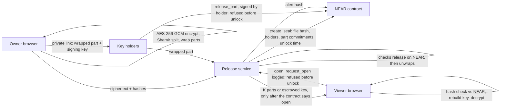

# Sealed Paper

**Lock a file so nobody can open it before the time you choose. Not even you.**

Pick a file (an exam paper, results, a tender, a will, a surprise video) and the exact date and time it may open. Before that time, every try to open it is **blocked, recorded in public and reported to you**. For extra safety you can name a few trusted people, and a set number of them must say yes before it opens.

The rules are enforced by a small program on the NEAR blockchain (test network), not by us, so nobody can quietly change them.

## Why

Sensitive files keep leaking before their release time, because whoever holds the file can open it:

| What happened | Source |
|---|---|
| **NEET-UG 2026, India:** the exam for about 22.79 lakh students was cancelled after the paper leaked on WhatsApp and Telegram | [The South First](https://thesouthfirst.com/health/neet-ug-2026-cancelled-after-paper-leak-row-cbi-probe-ordered-re-test-date-awaited/) |
| **UGC-NET 2024, India:** cancelled a day later after reports the paper was sold online; investigators later found no proof of a leak | [Deccan Herald](https://www.deccanherald.com/amp/story/india%2Fcbi-files-closure-report-in-ugc-net-paper-leak-case-3380116) |
| **UK Budget report, 2025:** opened about 40 minutes early by changing a web address, 24,000+ times | [Ross Martin](https://rossmartin.co.uk/sme-tax-news/8818-budget-leak-bigger-than-thought-says-nscs) |
| **US Supreme Court draft, 2022:** leaked; nearly 100 staff questioned and the leaker never found | [ABA Journal](https://abajournal.com/web/article/who-leaked-dobbs-scotus-investigators-dont-know-despite-97-employee-interviews-and-forensic-sleuthing) |

## Try it in 3 minutes

Hosted version: not online yet (deployment pending). Run it on your computer:

```sh
npm ci
cp .env.example .env     # fill SEAL_OPS_PRIVATE_KEY and SEAL_ESCROW_SECRET (or deploy your own contract, see below)
npm run dev:all          # then open http://localhost:8787
```

| Do this | You will see |
|---|---|
| Open the site and tap **Lock a file now** | A 3-step page: choose file, choose time, choose who must agree |
| Choose any PDF, tap **In 2 minutes**, choose **Some trusted people → 2 of 3 people**, tap **Lock my file** | "Done: your file is locked", share buttons (link, WhatsApp, email, calendar, QR code) and one private link per trusted person |
| Open the share link and tap **Open file** right away | **Still locked**: the try is blocked, recorded in public, and you get an alert |
| Open one trusted person's link and tap **Say yes** right away | **Too early**: also blocked and recorded |
| Wait for the countdown, tap **Say yes** on 2 of the 3 links, then **Open file** | The file opens with "✓ Checked: this is the same file that was locked" |
| Go to **My locked files** | Countdown, who said yes, every alert (time, device, rough location) and the public record of every try |
| Open **Check a locked file** and paste the share link | The public record read straight from the blockchain, so you don't have to trust us |
| Go to **Exam papers**, paste questions, choose 3 centres, tap **Make one paper per centre** | One different paper per centre, a fairness check, and **Find which centre** for a pasted leak |

### Words used in the app

| In the app | Meaning |
|---|---|
| Lock a file | Scramble it on your device and register the opening time on the blockchain |
| Trusted people | People who each hold one piece of the key |
| Say yes | A trusted person agrees to open it (only allowed after the time) |
| Public record | The blockchain log of every try, which nobody can delete or edit |
| Check a locked file | Read that record yourself |

## Proof it is live (NEAR test network)

- Program (smart contract): [`sealed.kanth_s.testnet`](https://testnet.nearblocks.io/address/sealed.kanth_s.testnet), [deploy transaction](https://testnet.nearblocks.io/txns/Dhev12vVQfyvRNyovugpNHJ3YwLQGPFPAPedrV3AMNmC); details in [docs/SEALED-DEPLOYMENT.json](docs/SEALED-DEPLOYMENT.json)
- Service account: [`sealops.kanth_s.testnet`](https://testnet.nearblocks.io/address/sealops.kanth_s.testnet)
- Hackathon tracks: **Privacy & Private AI** (main), Open Innovation

## What is guaranteed, and the honest limits

| Guaranteed | Honest limit |
|---|---|
| Nobody can open it before the chosen time | If our service **and** enough of your trusted people all work together, they could open it early |
| Only your trusted people can help, once each | For "just the time" files, our service keeps the key until then |
| Every try, even blocked ones, is in the public record | The person who locks the file already has the original |
| A changed file will not open, and you are told | Once it opens, someone can still take a photo of it |
| Your exact location is only shared if the visitor agrees | Rough location (when turned on) comes from the internet connection and can be wrong |

---

# For developers

## How it works



1. **Encrypt.** The browser encrypts the file with a random 256-bit key: AES-256-GCM in 1 MB chunks, each bound to its index and the chunk count, so altered, reordered or truncated files fail. The server only receives ciphertext and its SHA-256.
2. **Split.** In split mode the key is split into N Shamir parts with threshold K (the audited `shamir-secret-sharing` library). Each part is then **wrapped**: encrypted with a per-seal wrap key held by the release service and bound to that holder's account. Holders therefore cannot pool their parts offline before the time.
3. **Lock.** The contract stores the file hash, unlock time, mode, holder accounts, the SHA-256 of each wrapped part, and K. Holders get app-created testnet accounts (funded with 0.05 testnet NEAR) whose keys travel in their private link.
4. **Release.** Each holder signs `release_part` with their own key. The contract refuses it if the caller is not a holder, the time has not come, the part was already released, or the commitment differs. Every call, accepted or refused, is logged on-chain. The holder then hands the wrapped part to the release service, which unwraps it **only after confirming that release on NEAR**.
5. **Open.** A viewer's open request becomes an on-chain `request_open`, refused and logged before the time. After the time (and K releases), the service returns the parts or, in single mode, the escrowed key. The viewer's browser checks the downloaded file against the on-chain hash, rebuilds the key and decrypts.

### NEAR account access

- **Account lookup.** Typing a NEAR account (for example `kanth.testnet`) calls `/api/accounts/<id>`, which reads the account and its access keys from NEAR RPC. Sealing refuses accounts that do not exist.
- **Own-account holders.** A holder can be any existing NEAR account. Their part is wrapped to that account, the contract lists that account as a holder, and only that account can call `release_part` for it, signed in Meteor Wallet. Holders without an account get an app-created testnet account instead.
- **Who can open.** An optional allow-list of up to 50 accounts. Before releasing a key or parts, the server issues a one-time challenge (5 minutes, single use, bound to the seal). The viewer signs it in their wallet (NEP-413). The server checks the signature, and that the signing key is a full-access key of that account on-chain right now. Unlisted accounts are refused with a `not_allowed` alert whose hash is written on-chain. The allow-list is enforced by the release service, not the contract.

### Exam mode

Three rule-based agents run in the browser (`lib/exam.js`):

- **Setter.** Gives each centre a version with a different question order, option order and meaning-preserving wording (for example "What is" / "Find"). The questions, options and correct answers stay the same. It is deterministic per exam and centre, and makes sure every centre's version is distinct.
- **Auditor.** Confirms every version has the same questions, option sets and correct answers, with stem length within 10% of the original.
- **Investigator.** Finds question stems, options and wording choices in a pasted leak (partial or retyped). It scores each centre by how well its order and wording match, and reports "Centre N, NN% confidence".

The owner can write the SHA-256 of a report on-chain against a seal (`record_alert` with kind `leak_report` or `exam_audit`).

Measured in the unit tests on simulated leaks (30–90% of a test paper, retyped in lowercase without brackets), it traced 100 of 100 leaks correctly for 3, 8 and 20 centres, with median confidence 94%, 86% and 80%. Real leaks that paraphrase heavily, photograph pages, or mix versions would be harder. OCR of photos and AI rewording are not implemented.

### Alerts

These events create an alert: an open attempt before the unlock time, an early release, a release by a non-holder, an open attempt by an account not on the allow-list, a wrong key (AES-GCM authentication failure), a file whose hash differs from NEAR, and 5 failures from one source within 2 minutes (escalation).

Each alert records:
- the event and the time in IST and UTC
- the NEAR account, if any
- device and browser
- approximate location from the IP address, if `GEOIP_URL` is configured

Exact GPS is included only when the visitor ticks "Share my exact location". Every open page shows the notice: "attempts to open this file are logged, including approximate location".

The full record stays off-chain. Its SHA-256 is written on-chain with `record_alert`.

Notifications go by email (Resend) and WhatsApp/SMS (Twilio) only when those are configured; otherwise nothing is sent and the alert is marked "not configured". Every alert also appears in the owner's in-app feed.

## Trust model (what is enforced, what is trusted)

| Claim | Enforced by |
|---|---|
| No holder release and no open request succeeds before the unlock time | NEAR contract (block time) |
| Only listed holders can release, once each, with their committed part | NEAR contract |
| Every attempt, including refusals, is public and permanent | NEAR contract log (up to 300 entries per seal; overflow is counted) |
| A changed file is detected before decryption | SHA-256 on NEAR, checked in the viewer's browser; AES-GCM authentication |
| Fewer than K parts reveal nothing about the key | Shamir secret sharing |
| Holders cannot combine parts early on their own | Parts are wrapped with a key only the release service holds |
| Only allow-listed accounts can open | Release service: NEP-413 signature plus an on-chain full-access-key check (not the contract) |

**What you must trust:**
- **Split mode:** the release service plus K holders, if they all collude, could open early. Neither side alone can. The service never sees a part before its holder releases it on-chain.
- **Single mode:** the release service holds the file key (encrypted at rest) and is trusted to release it only after the contract says the seal is open. This is a server-held escrow, not a cryptographic time-lock. A trustless time-lock would need something like drand tlock, which is not used.
- **The person who seals** already has the original file. The guarantee covers everyone who receives the sealed copy.
- **After opening**, nothing stops someone photographing or copying the file.
- **App-created holder accounts** carry their key inside the private holder link, so anyone with that link can act as that holder. Holders who enter their own NEAR account sign with their wallet, and their link alone cannot release anything. There is no passkey or FastAuth login.

## Real vs not built

| Real | Not built or needs configuration |
|---|---|
| Contract on NEAR testnet; all seals, releases, refusals and alert hashes in this README are real testnet transactions | Email/WhatsApp/SMS send only when Resend/Twilio keys are configured; otherwise they print to the console |
| Browser encryption, Shamir split, wrapped parts, hash checks | IP location only when `GEOIP_URL` points to a lookup service |
| Holder signing with app-created accounts or the holder's own Meteor Wallet; NEP-413 viewer proofs | The Meteor Wallet popup itself is tested by hand; automated tests sign the same messages with near-api-js |
| Share link, WhatsApp link, email (mailto) with .ics invite, Web Share, printable QR, downloadable `.sealed` file | |
| Exam-mode Setter, Auditor and Investigator (rule-based, in the browser); report hashes on NEAR | Exam mode uses no AI: no NEAR AI agents, no OCR of photographed leaks, no attested reports |
| | No mainnet, no payments, no hosted deployment yet |

## Tests

```sh
npm test               # 26 unit tests (incl. exam mode: 20 simulated leaks, at least 18 must trace): crypto round-trips (PDF, image, video, text), Shamir 2-of-2 / 3-of-5 / 5-of-7,
                       # K-1 parts fail, wrong part, tamper/reorder/truncate, wrapped parts, alerts, escrow,
                       # NEP-413 proofs (forged key, function-call key, replay, expiry)
npm run contract:test  # 10 contract tests: early refusal, non-holder, commitments, K-of-N, single mode, operators, log cap
npm run test:browser   # 3 offline browser tests (no keys, no chain writes), incl. exam mode
npm run test:chain     # live testnet: early refusal, non-holder refusal, 2-of-3 unlock
npm run test:access    # live testnet, against a running server: account lookup, own-account holder,
                       # allow-list (no proof, forged key, unlisted account, early, allowed opens and decrypts)
npm run test:e2e       # live testnet browser E2E (~3 min): seal PDF 2-of-3 + single text, early release and open refused
                       # with alerts, release after unlock, PDF matches original, single opens automatically,
                       # tampered file → FILE TAMPERED, alerts and their public records, verify page
```

Latest results: 26 unit, 10 contract and 3 offline browser tests pass. The live tests (`test:chain`, `test:access`, `test:e2e`) all passed earlier on 14 November. They are now waiting for the service account `sealops.kanth_s.testnet` to be topped up with test NEAR, because it spent its balance funding test files.

### Deploy your own contract (test network)

```sh
npm run contract:test     # 10 Rust unit tests
npm run contract:build
CONTRACT_OWNER=<your>.testnet npm run contract:deploy              # prints the plan
CONTRACT_OWNER=<your>.testnet npm run contract:deploy -- --broadcast
```

This creates `sealops.<you>` (service account, 3 NEAR) and `sealed.<you>` (contract, 4 NEAR), signing with near CLI's keychain. New keys are written to `.env` and never printed. Set `NEAR_RPC_URLS`, `NEAR_EXPLORER_URL`, `SEAL_HOLDER_FUNDING_NEAR` and `SEAL_ESCROW_SECRET` as in `.env.example`.

### Hosting on Vercel

`vercel.json` routes every page through one function, so the security headers apply everywhere. Connect **Vercel Blob** (encrypted files, uploaded straight from the browser) and **Upstash Redis** (records, alerts, rate limits, one-time codes) in the Vercel dashboard, and add the `.env` values as environment variables. Without Blob and Redis connected, the hosted site refuses to lock files instead of losing them.

## Stack and libraries

Plain browser ES modules and a Node `http` server, deliberately reusing the earlier project's tested UI and server shell instead of Next.js/Fastify/Prisma. Storage is the local filesystem (`data/`).

| Library | Use |
|---|---|
| [near-sdk](https://crates.io/crates/near-sdk) 5.30 (Rust) | Contract |
| [near-api-js](https://www.npmjs.com/package/near-api-js) 7.2 | Operator and holder transactions, RPC failover |
| [shamir-secret-sharing](https://www.npmjs.com/package/shamir-secret-sharing) 0.0.4 | Key splitting (audited by Cure53 and Zellic) |
| [qrcode-generator](https://www.npmjs.com/package/qrcode-generator) 1.4.4 | QR codes, generated locally |
| [@near-wallet-selector/core and meteor-wallet](https://github.com/near/wallet-selector) 10.1.4 | Own-account holders sign releases; viewers sign NEP-413 proofs |
| buffer, process, util | Browser shims for near-api-js |
| esbuild, Playwright | Build and browser tests (dev only) |
| WebCrypto | AES-256-GCM, SHA-256 (built into browsers and Node) |

External services, all configured in `.env`: NEAR testnet RPC endpoints (`NEAR_RPC_URLS`), block explorer (`NEAR_EXPLORER_URL`), IP location (`GEOIP_URL`, optional), Resend and Twilio (optional), Vercel Blob and Upstash Redis (on Vercel).

## Hackathon history and AI assistance

Sealed Paper was written during the hackathon window, on 14 November 2026. Earlier commits in this repository belong to a different, abandoned idea and are not part of this submission.

Most of the code was written with AI coding assistants (Claude Code; Codex on the earlier project) under the author's direction. The author chose the product and made the deployment and trust decisions.

Licensed under [MIT](LICENSE). Evidence and exam-security support only; not legal advice.
