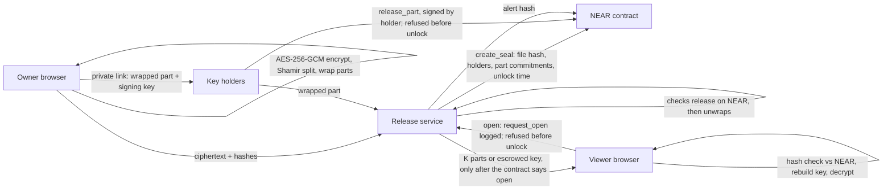

# Sealed Paper

**Files nobody can open before the second you choose.**

Seal any file (exam paper, tender, results, will, video) until an exact date and time. Optionally split its key across 2 to 20 holders, of whom K must release their parts. A NEAR testnet contract refuses every early release or open, writes every attempt to a public log, and the owner gets an alert with the time, device and approximate location.

- Contract: [`sealed.kanth_s.testnet`](https://testnet.nearblocks.io/address/sealed.kanth_s.testnet) ([deploy tx](https://testnet.nearblocks.io/txns/Dhev12vVQfyvRNyovugpNHJ3YwLQGPFPAPedrV3AMNmC), details in [docs/SEALED-DEPLOYMENT.json](docs/SEALED-DEPLOYMENT.json))
- Release-service operator: [`sealops.kanth_s.testnet`](https://testnet.nearblocks.io/address/sealops.kanth_s.testnet)
- Tracks: **Privacy & Private AI** (primary), Open Innovation
- Product brief and the real leak events behind it: [PRD-Sealed-Paper-v2-TimeLock.md](PRD-Sealed-Paper-v2-TimeLock.md)

## Why

Sensitive files keep leaking before their release time, because whoever holds the file can open it:

| Event | What happened |
|---|---|
| NEET-UG 2026, India | Exam for about 22.79 lakh students cancelled after a leaked "guess paper" matched real questions ([source](https://thesouthfirst.com/health/neet-ug-2026-cancelled-after-paper-leak-row-cbi-probe-ordered-re-test-date-awaited/)) |
| UGC-NET 2024, India | Exam cancelled after reports the paper was sold on Telegram; the CBI later filed a closure report finding no evidence of a leak ([source](https://www.deccanherald.com/amp/story/india%2Fcbi-files-closure-report-in-ugc-net-paper-leak-case-3380116)) |
| UK Budget report, Nov 2025 | Reachable about 40 minutes early by editing a URL; accessed 24,000+ times before the speech ([source](https://rossmartin.co.uk/sme-tax-news/8818-budget-leak-bigger-than-thought-says-nscs)) |
| US Supreme Court Dobbs draft, 2022 | Leaked; nearly 100 staff interviewed and the source never identified ([source](https://abajournal.com/web/article/who-leaked-dobbs-scotus-investigators-dont-know-despite-97-employee-interviews-and-forensic-sleuthing)) |

## Try it

Requires Node 22 or newer.

```sh
npm ci
cp .env.example .env      # then fill SEAL_OPS_PRIVATE_KEY and SEAL_ESCROW_SECRET, or deploy your own (below)
npm run dev:all           # builds the browser bundle and starts http://localhost:8787
```

| Do this | See this |
|---|---|
| Open `/app` → **Seal a file**, choose a PDF, preset **2 of 3**, click **+2 min**, **Seal and lock on NEAR** | Seal created on NEAR (tx link), share buttons, QR code, and 3 private holder links shown once |
| Open a holder link and click **Release my part** before the time | "Refused: too early". The refusal is on NEAR and the owner gets an alert |
| Open the share link `/s/<id>` and click **Open file** before the time | "Refused: still locked", logged on-chain, alert created |
| After the countdown, release from 2 holder links, then **Open file** | The key is rebuilt in the browser; the file's hash is checked against NEAR, then it opens (PDF, image, video, audio or text preview) |
| Seal a file in **Single lock** mode and leave its share page open | It opens automatically at its time, with no holders |
| Change any byte of `data/seals/<id>.sealed`, then open | **FILE TAMPERED**, nothing decrypted, alert created |
| **My seals** | Countdown, release progress, alert feed (with on-chain hash links) and the on-chain access log |
| `/verify?id=<id>` | Seal record and full access log read directly from NEAR RPC in your browser |
| **Visual shares** | An image split into N noise images that reveal it only when all are combined |

Without a deployed contract and operator key, pages load but sealing is refused with a clear error.

### Deploy your own contract (testnet)

```sh
npm run contract:test     # 10 Rust unit tests
npm run contract:build
CONTRACT_OWNER=<your>.testnet npm run contract:deploy              # prints the plan
CONTRACT_OWNER=<your>.testnet npm run contract:deploy -- --broadcast
```

It creates `sealops.<you>` (operator, 3 NEAR) and `sealed.<you>` (contract, 4 NEAR), signing with near CLI's keychain. New keys are generated locally and appended to `.env`, never printed. It also prints explorer links.

## How it works



1. **Encrypt.** The browser encrypts the file with a random 256-bit key: AES-256-GCM in 1 MB chunks, each bound to its index and the chunk count, so altered, reordered or truncated files fail. The server only receives ciphertext and its SHA-256.
2. **Split.** In split mode the key is split into N Shamir parts with threshold K (the audited `shamir-secret-sharing` library). Each part is then **wrapped**: encrypted with a per-seal wrap key held by the release service and bound to that holder's account. Holders therefore cannot pool their parts offline before the time.
3. **Lock.** The contract stores the file hash, unlock time, mode, holder accounts, the SHA-256 of each wrapped part, and K. Holders get app-created testnet accounts (funded with 0.05 testnet NEAR) whose keys travel in their private link.
4. **Release.** Each holder signs `release_part` with their own key. The contract refuses it if the caller is not a holder, the time has not come, the part was already released, or the commitment differs. Every call, accepted or refused, is logged on-chain. The holder then hands the wrapped part to the release service, which unwraps it **only after confirming that release on NEAR**.
5. **Open.** A viewer's open request becomes an on-chain `request_open`, refused and logged before the time. After the time (and K releases), the service returns the parts or, in single mode, the escrowed key. The viewer's browser checks the downloaded file against the on-chain hash, rebuilds the key and decrypts.

### Alerts

These events create an alert: an open attempt before the unlock time, an early release, a release by a non-holder, a wrong key (AES-GCM authentication failure), a file whose hash differs from NEAR, and 5 failures from one source within 2 minutes (escalation).

Each alert records:
- the event and the time in IST and UTC
- the NEAR account, if any
- device and browser
- approximate location from the IP address (ipapi.co by default; configurable, with a mock for tests)

Exact GPS is included only when the visitor ticks "Share my exact location". Every open page shows the notice: "attempts to open this file are logged, including approximate location".

The full record stays off-chain. Its SHA-256 is written on-chain with `record_alert`.

Notifications go by email (Resend) and WhatsApp/SMS (Twilio) when those are configured. Otherwise they go to a console provider. Every alert also appears in the owner's in-app feed.

## Trust model (what is enforced, what is trusted)

| Claim | Enforced by |
|---|---|
| No holder release and no open request succeeds before the unlock time | NEAR contract (block time) |
| Only listed holders can release, once each, with their committed part | NEAR contract |
| Every attempt, including refusals, is public and permanent | NEAR contract log (up to 300 entries per seal; overflow is counted) |
| A changed file is detected before decryption | SHA-256 on NEAR, checked in the viewer's browser; AES-GCM authentication |
| Fewer than K parts reveal nothing about the key | Shamir secret sharing |
| Holders cannot combine parts early on their own | Parts are wrapped with a key only the release service holds |

**What you must trust:**
- **Split mode:** the release service plus K holders, if they all collude, could open early. Neither side alone can. The service never sees a part before its holder releases it on-chain.
- **Single mode:** the release service holds the file key (encrypted at rest) and is trusted to release it only after the contract says the seal is open. This is a server-held escrow, not a cryptographic time-lock. A trustless time-lock would need something like drand tlock, which is not used.
- **The person who seals** already has the original file. The guarantee covers everyone who receives the sealed copy.
- **After opening**, nothing stops someone photographing or copying the file.
- **Holder accounts** are created by the app on testnet and their keys travel in the private holder link. Anyone with a holder's link can act as that holder. There is no passkey or FastAuth login.

## Real vs simulated

| Real | Simulated or not built |
|---|---|
| Contract on NEAR testnet; all seals, releases, refusals and alert hashes in this README are real testnet transactions | Email/WhatsApp/SMS send only when Resend/Twilio keys are configured; otherwise they print to the console |
| Browser encryption, Shamir split, wrapped parts, hash checks | IP location uses ipapi.co by default; tests use a fixed mock (Chennai) |
| Holder signing from the browser with app-created testnet accounts | **Exam mode** (Setter, Auditor and Investigator AI agents, leak tracing) is **not built** |
| Share link, WhatsApp link, email (mailto) with .ics invite, Web Share, printable QR, downloadable `.sealed` file | Visual shares are an XOR-based demonstration of splitting an image, not the mechanism that protects the key |
| | No mainnet, no payments, no hosted deployment yet |

## Tests

```sh
npm test               # 13 unit tests: crypto round-trips (PDF, image, video, text), Shamir 2-of-2 / 3-of-5 / 5-of-7,
                       # K-1 parts fail, wrong part, tamper/reorder/truncate, wrapped parts, alerts, escrow
npm run contract:test  # 10 contract tests: early refusal, non-holder, commitments, K-of-N, single mode, operators, log cap
npm run test:browser   # 3 offline browser tests (no keys, no chain writes)
npm run test:chain     # live testnet: early refusal, non-holder refusal, 2-of-3 unlock
npm run test:e2e       # live testnet browser E2E (~3 min): seal PDF 2-of-3 + single text, early release and open refused
                       # with alerts, release after unlock, PDF matches original, single opens automatically,
                       # tampered file → FILE TAMPERED, alerts with location and on-chain hashes, verify page
```

## Stack and libraries

Plain browser ES modules and a Node `http` server, deliberately reusing the earlier project's tested UI and server shell instead of Next.js/Fastify/Prisma. Storage is the local filesystem (`data/`).

| Library | Use |
|---|---|
| [near-sdk](https://crates.io/crates/near-sdk) 5.30 (Rust) | Contract |
| [near-api-js](https://www.npmjs.com/package/near-api-js) 7.2 | Operator and holder transactions, RPC failover |
| [shamir-secret-sharing](https://www.npmjs.com/package/shamir-secret-sharing) 0.0.4 | Key splitting (audited by Cure53 and Zellic) |
| [qrcode-generator](https://www.npmjs.com/package/qrcode-generator) 1.4.4 | QR codes, generated locally |
| buffer, process, util | Browser shims for near-api-js |
| esbuild, Playwright | Build and browser tests (dev only) |
| WebCrypto | AES-256-GCM, SHA-256 (built into browsers and Node) |

External services: NEAR testnet RPC (FastNEAR, rpc.testnet.near.org), ipapi.co (optional), Resend and Twilio (optional).

## Hackathon history and AI assistance

This repository started as a different project, Appeal (worker evidence records), preserved at the tag [`appeal-final`](https://github.com/Lakshmikanth-3/Appeal/tree/appeal-final). Sealed Paper replaced it on 14 November 2026. Its contract, crypto, release service, alerts and pages were written that day. It reuses Appeal's visual theme and server patterns.

Most of the code was written with AI coding assistants (Claude Code; Codex on the earlier project) under the author's direction. The author chose the product and made the deployment and trust decisions.

Licensed under [MIT](LICENSE). Evidence and exam-security support only; not legal advice.
