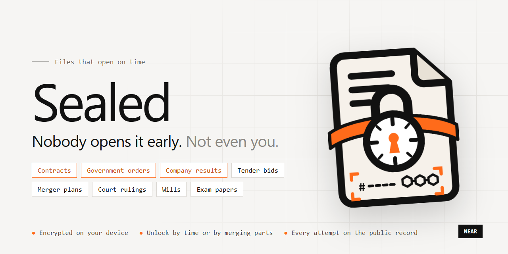

<p align="center"></p>

# Sealed: Complete Project Report

**Files that open on time.** Lock any important document (a contract, a government order, company results, a tender bid, a will or an exam paper) so that nobody can open it before the right moment, not even the person who locked it. Every rule runs on a NEAR smart contract, and every attempt is recorded in public.

| | |
|---|---|
| Live app | https://sealedfiles.vercel.app |
| Source code | https://github.com/Lakshmikanth-3/Sealed |
| Network | NEAR testnet |
| Lock contract | [`sealed.kanth_s.testnet`](https://testnet.nearblocks.io/address/sealed.kanth_s.testnet) |
| Plans contract | [`plans.sealops.kanth_s.testnet`](https://testnet.nearblocks.io/address/plans.sealops.kanth_s.testnet) |
| Service account | [`sealops.kanth_s.testnet`](https://testnet.nearblocks.io/address/sealops.kanth_s.testnet) |
| Hosting | Vercel (functions), Vercel Blob (encrypted files), Upstash Redis (records) |
| Demo video | `demo/sealed-live-demo.mp4` (8 min 11 s, narrated, not in Git) |
| Report date | 15 November 2026 |
| Commits | 82 (12 to 14 November 2026) |

---

## 1. The problem

Important documents must often stay closed until a fixed moment, in every field:

| Field | Documents |
|---|---|
| Companies | Quarterly results, merger and acquisition plans, board papers, salary letters, product launches |
| Government | Orders, budget reports, policy papers, tender bids |
| Legal | Contracts, court rulings, settlement terms |
| Families | Wills, time capsules |
| Education and hiring | Exam papers, recruitment tests, results |
 Today, whoever holds the file can open it early, and afterwards nobody can prove who did what, or when.

Real cases of documents opened or leaked early:

| Event | What happened |
|---|---|
| NEET-UG 2026, India | The exam for about 22.79 lakh students was cancelled after the paper leaked on WhatsApp and Telegram |
| UGC-NET 2024, India | Cancelled a day later after reports the paper was sold online |
| UK Budget report, 2025 | Could be opened about 40 minutes early by changing a web address; opened over 24,000 times |
| US Supreme Court, 2022 | A draft ruling leaked; nearly 100 staff questioned, the leaker never found |

## 2. The solution in one paragraph

The file is encrypted in the owner's browser (AES-256-GCM), so the server only ever stores scrambled bytes. The owner chooses **who it is for** (one person, or split between several people) and **how it unlocks** (on a date and time, or only when enough key parts are merged). A NEAR smart contract enforces the rule: it refuses every early or unauthorised attempt and writes each attempt to a public log that cannot be deleted. When the rule is met, the key is released and the file is decrypted on the receiver's device. A fingerprint (SHA-256) recorded at locking time proves the opened file is the original.

---

## 3. Features

### 3.1 Lock a file

The flow follows three questions:

1. **Choose any file:** photo, video, audio, document or anything else, up to 100 MB (10 MB on Free).
2. **Who is it for?**
   - **One person:** a private link.
   - **Split between several people:** the key is split into parts with Shamir secret sharing, one part per person (2 to 20). The owner picks how many must agree, for example 2 of 3.
3. **How does it unlock?**
   - **On a date and time:** nobody can open it before then.
   - **Only when the parts are merged:** no time limit; it opens as soon as enough parts are merged.

| Who | Unlock | How it is enforced |
|---|---|---|
| One person | Date and time | `single` mode: opens by itself at the time |
| One person | Merge | 2-of-2 split: the sender keeps part 1, the receiver gets part 2 |
| Several people | Date and time | K-of-N split: after the time, K people must say yes |
| Several people | Merge | K-of-N split: opens as soon as K parts are merged |

Optional settings: alerts by email or WhatsApp number, and an allow-list of NEAR accounts that may open the file.

After locking, the owner gets the share link (copy, WhatsApp, email, QR code), one private link per trusted person, and a link to the real NEAR transaction.

### 3.2 Opening page (`/s/<id>`)

- A live countdown, or for merge-only files a parts counter ("0 / 2").
- **Open file** asks the contract. Too early: refused, recorded on NEAR, and the owner is alerted with the time, device and rough location (exact location only if the visitor ticks a box).
- Time-only files open by themselves when the time comes.
- After opening, the file is checked against its fingerprint ("this is the same file that was locked") and shown in the page (text, image, PDF, video, audio) or downloaded.
- A tampered stored file is refused and an alert is recorded.
- Public record of every attempt for that file.

### 3.3 Trusted person page (`/h/<id>#secret`)

- The person's encrypted key part travels in the link fragment (never sent to the server).
- **Say yes** (time mode) or **Merge my part** (merge mode). The part is checked against its commitment stored on NEAR.
- People can use their own NEAR account and wallet, or an account the app creates and funds for them inside the link.
- Early or wrong attempts are refused and recorded.

### 3.4 My files: cancel or replace

- Every file locked on this device, with countdowns, progress and alerts.
- **Cancel:** the escrowed key is destroyed and the cancellation is recorded on NEAR; the file can never be opened.
- **Replace with a new version:** locks the new file, then cancels the old one.

### 3.5 Live chat (two people, like WhatsApp)

- Start a chat with a name and get an invite link. Only the first person who opens it can join; a third person is refused.
- **End-to-end encrypted:** the AES-256 key lives only in the invite link fragment. The server stores ciphertext it cannot read.
- WhatsApp-style interface: ✓ sent, ✓✓ delivered, blue ✓✓ read, "typing…", "online", "last seen".
- Send text, photos, videos, audio, documents (up to 25 MB, encrypted before upload) and **voice notes** (tap the mic).
- **⏱ Sealed until a time:** the receiver sees a locked bubble with a countdown; the server withholds the message until then.
- **① View once:** opened a single time, then deleted from the server; the sender sees "Opened".
- Updates arrive every 1.5 s (Vercel has no WebSockets).

### 3.6 One-time secret links

A one-way message or file that opens at a time, optionally view once and limited to one NEAR account. Recorded on NEAR. Found under the chat tab.

### 3.7 Question papers and leak tracing (one use case among many)

- Paste questions; Sealed makes one version per exam centre (same questions, different order and wording) plus a fairness check.
- Each version is locked to open at the exam time in its own centre.
- If a paper leaks (retyped or pasted), **Find which centre** compares order and wording: for example "Centre 2, 86% confidence, based on 29 clues". With too little text it says so instead of guessing.
- The report can be downloaded and its fingerprint recorded on NEAR. Works offline, with no AI service.

### 3.8 Plans (Free and Premium, paid in NEAR)

| | Free | Premium |
|---|---|---|
| Locked files | 5 per day | Unlimited |
| File size | 10 MB | 100 MB |
| Trusted people | up to 3 | up to 20 |
| Chat, secret links, alerts, proof page | Yes | Yes |

Premium is `subscribe(months)` on the plans contract with exactly price × months attached; renewals stack. One NEP-413 wallet signature proves the account, the server checks `get_plan` on NEAR, and the browser gets a signed 24-hour pass. Wallet: Meteor, through NEAR Wallet Selector.

The price is stored on the contract (currently **1 NEAR / month**; a change to 10 NEAR is prepared, see section 11).

### 3.9 Check a file and Proof

- **Check a file (`/verify`):** paste a link (and optionally a downloaded copy) to see the public record and confirm the file was not changed. It reads NEAR directly.
- **Proof (`/proof`):** live counts from the contract, the deployment and upgrade transactions, and the most recent real transactions, each linked to the NEAR explorer.

### 3.10 Landing page

An editorial design (off-white, large light headlines, mono labels, black pill buttons), inspired by the layout and type of a reference template, with no copied branding:

- **Hero:** a 3D paper animation in six steps (written → sealed → encrypted → split into 3 → merged → decrypted and opened), with mouse parallax and a rotating headline ("Sealed until the signing / the tender / the launch / the hearing / the results").
- **Watch how it works:** an 8-chapter 3D story with captions and NEAR "blocks". A person writes a paper, it is sealed, path A opens by time (with an early attempt refused), path B splits and merges, and two phones exchange encrypted chat messages and files.
- The page leads with every field (contracts, government orders, company results, tender bids, merger plans, court rulings, wills, exam papers); the chat illustration shows a legal team sending a merger agreement.
- Live numbers ticker, capabilities, a dark "how it works" section with a chat animation, a live public-record panel, big live numbers, security cards, real leak events, a use-case marquee, guarantees and honest limits, and a call to action.

---

## 4. Architecture

```
Browser (the only place files and keys are readable)
  ├─ AES-256-GCM encryption, SHA-256 fingerprint, Shamir split  (lib/sealcrypto.js)
  ├─ Trusted people sign with their own key or an app-made one   (NEP-413 / near-api-js)
  └─ Chat: AES-256-GCM with a key that exists only in the link   (public/chat-store.js)
        │
        ▼  ciphertext only
Server (Node.js; Vercel functions in production)   server/index.js
  ├─ Stores ciphertext: local disk, or Vercel Blob (browser uploads directly)
  ├─ Records: local files, or Upstash Redis (kv)
  ├─ Escrows the key for time-only files (encrypted with SEAL_ESCROW_SECRET)
  ├─ Rate limits, Free/Premium limits, alerts, chat relay
  └─ Operator account signs contract calls (serialized; stale nonces retried)
        │
        ▼
NEAR testnet
  ├─ sealed.kanth_s.testnet   create_seal · release_part · request_open · record_alert · views
  └─ plans.sealops.kanth_s.testnet   subscribe · get_plan · set_price · withdraw
```

### 4.1 Lock contract (`contract/src/lib.rs`, Rust, near-sdk 5.30)

| Method | What it does |
|---|---|
| `create_seal` | Operator only. Stores file hash, unlock time, mode (`single` / `split`), holders, part commitments, K and N |
| `release_part` | A holder releases their part. Answers `released`, `early`, `not_holder`, `already_released`, `bad_commitment` or `single_mode` |
| `request_open` | Answers `early`, `awaiting_parts` or `open` |
| `record_alert` | Operator only. Stores an alert fingerprint (no personal data) |
| `get_seal`, `get_log`, `is_unlocked`, `get_config` | Public views |

Refusals are logged instead of failing the transaction, so every attempt leaves a public record. The log is capped at 300 entries per file.

### 4.2 Plans contract (`contract-plans/src/lib.rs`)

| Method | What it does |
|---|---|
| `subscribe(months)` | Payable; exactly price × months; 1 to 12 months; renewals stack |
| `get_plan(account)` | Premium end time and whether it is active |
| `get_config` | Owner, price, number of subscriptions |
| `set_price`, `withdraw` | Owner, or (after the prepared upgrade) the contract account itself |

### 4.3 Server API (main routes)

| Route | Purpose |
|---|---|
| `POST /api/seals` | Lock a file (direct body, or a Blob URL on Vercel) |
| `GET /api/seals/:id` | Public details plus on-chain state |
| `POST /api/seals/:id/open` | Ask the contract; returns the key when open |
| `POST /api/seals/:id/parts` | Store a released part |
| `POST /api/seals/:id/alerts`, `GET …/alerts` | Record and read alerts |
| `POST /api/seals/:id/cancel` | Owner cancels |
| `GET /api/seals/:id/log`, `…/file`, `…/challenge` | Public log, ciphertext, NEP-413 challenge |
| `POST /api/upload` | Vercel Blob client-upload token |
| `/api/chat`, `/api/chat/:id/{join,messages,state,files}` | Live chat |
| `/api/plan`, `/api/plan/challenge`, `/api/plan/pass` | Plans and the Premium pass |
| `/api/config`, `/api/chain`, `/api/activity`, `/api/accounts/:id` | Settings, contract status, public activity, account lookup |

Pages: `/`, `/app`, `/s/:id`, `/h/:id`, `/c/:id`, `/verify`, `/proof`.

### 4.4 Security choices

- Files and chat messages are encrypted in the browser; the server never sees plaintext.
- Key parts and chat keys travel in URL fragments (`#…`), which browsers never send to servers.
- Strict Content-Security-Policy (no inline scripts; connections only to our origin, the NEAR RPCs, the wallet and Blob storage), `frame-ancestors 'none'`, no referrer.
- NEP-413 signed proofs with one-time challenges for allow-listed opening and Premium.
- Separate operator keys for local, hosted and test use, so their nonces never collide.
- Rate limits shared across serverless instances through Redis.

---

## 5. Technology

| Area | Used |
|---|---|
| Smart contracts | Rust, near-sdk 5.30, cargo-near |
| Server | Node.js 24, plain `http` (no framework) |
| NEAR client | near-api-js 7.2.0, @near-wallet-selector 10.1.4 (Meteor) |
| Crypto | WebCrypto AES-256-GCM, SHA-256, shamir-secret-sharing 0.0.4 |
| Storage | Vercel Blob, Upstash Redis (local: disk and memory) |
| Front end | Plain HTML, CSS and JavaScript modules; canvas and CSS 3D animations |
| Tests | node:test, Rust unit tests, Playwright (real Chrome) |
| Code size | about 7,000 lines (JavaScript, Rust, HTML, CSS) |

---

## 6. Test results

| Suite | Command | Result |
|---|---|---|
| Unit | `npm test` | **36 passed**: encryption round-trips, Shamir 2-of-2 / 3-of-5 / 5-of-7, tamper detection, alerts, escrow, NEP-413, shared rate limits, exam tracing, chat rules, stale-nonce retry |
| Lock contract | `npm run contract:test` | **10 passed** |
| Plans contract | `npm run plans:test` | **8 passed** (includes the new admin test) |
| Browser, offline | `npm run test:browser` | **3 passed** |
| Live access (testnet) | `npm run test:access` | **22 / 22 passed** (allow-list, own-account holder, cancel, Free limit, real Premium payment) |
| Live end to end (testnet) | `npm run test:e2e` | **passed**: lock 2-of-3, refuse early, release, open, auto-open, tamper |
| Live chat (hosted site) | `npm run test:chat [url]` | **17 / 17 passed**: two browsers, files byte-for-byte, view once, timed message |
| Live demo + UI test (hosted) | `npm run demo:video` | **22 / 22 passed** while recording the narrated video |

---

## 7. Proof: real transactions

From one file locked by the live end-to-end test (2 of 3 trusted people):

| Step | Contract answered | Transaction |
|---|---|---|
| File locked | seal created | [`4tSyfouQ…`](https://testnet.nearblocks.io/txns/4tSyfouQYNxzTefHm68LnRC15Z8XGmaQw2oYfkXCCi6d) |
| Opened too early | `early` (blocked) | [`AazsNote…`](https://testnet.nearblocks.io/txns/AazsNotehoFXTM6wxsoQxzUo1Ym6curTSUQdX2LapaSY) |
| Trusted person said yes | `released` | [`CT6Gkrzn…`](https://testnet.nearblocks.io/txns/CT6GkrznipTwz4xeWj1tBtX3PQRCstHteqa2nnVw7kdG) |
| Opened after 2 of 3 | `open` | [`4qrZWQoQ…`](https://testnet.nearblocks.io/txns/4qrZWQoQvdudw8UdQrttPKXRnpHSaNvDSSdBYXoB8iMK) |
| Altered file refused | alert logged | [`DEQauyof…`](https://testnet.nearblocks.io/txns/DEQauyofi7hdNV59RH91fxbNmxAtW97V7X774jhXF3pj) |
| Owner cancelled | logged | [`H8R7Y2Hh…`](https://testnet.nearblocks.io/txns/H8R7Y2HhGYtd7b25SWaWznDSv9CmhiQFBgfY1aah9VKe) |
| View-once message opened | logged | [`EQX82xWM…`](https://testnet.nearblocks.io/txns/EQX82xWM5tUzHNSx6ibwTJ3XPYGFiBU3g2mBrgfXBbE1) |
| Premium bought | Premium active | [`ELhmFabL…`](https://testnet.nearblocks.io/txns/ELhmFabLuo7E3D8uYDx73JNK71Z2PY4ARuzkwof1DBMe) |

Deployment: lock contract [`Dhev12vV…`](https://testnet.nearblocks.io/txns/Dhev12vVQfyvRNyovugpNHJ3YwLQGPFPAPedrV3AMNmC), upgrade [`8YRc1AFZ…`](https://testnet.nearblocks.io/txns/8YRc1AFZD273JpJGWs4h8uNHfUSwoF2XBq8Ai99JqJXv); plans contract [`4FcvXCyM…`](https://testnet.nearblocks.io/txns/4FcvXCyMX5upAJ3Y4J8UrTKKEUkg7XGnCnqeYV4qeDZC). The contract had recorded about 76 locked files at the time of writing.

---

## 8. Demo video

`demo/sealed-live-demo.mp4`: 8 min 11 s, 1280 × 720, with a male voice-over (Windows "Microsoft David"). It was recorded on the live site with real transactions and passed 22 of 22 checks during recording. Re-record with `npm run demo:video` (set `FFMPEG_PATH` for the voice track).

Contents: title card; the 8-chapter 3D story; live numbers; a company's quarterly results locked until the announcement, refused early and then opened on time; a merger agreement split between the CEO, the CFO and the head of legal, opened only after 2 parts were merged; the proof page; question papers traced to the leaking centre; a two-person legal chat with a signed contract (PDF), a photo, a view-once message and a timed message; Premium active; end card.

---

## 9. Problems found and fixed during live testing

| Problem | Cause | Fix |
|---|---|---|
| Locking failed on the hosted site with "Exceeded 2 providers" | Several Vercel instances share one key; a stale nonce was resent to every RPC | Writes pass nonce errors through so near-api-js retries with a fresh nonce, and report the real error |
| Trusted person page showed the previous person | Opening another person's link in the same tab changes only the `#` part | The page reloads on `hashchange` |
| Merge-only files showed a countdown and "Say yes" | Unlock choice was not stored | The server stores `unlockBy`; pages show a parts counter and "Merge my part" |
| Exam tracer contradicted itself with too little text | Showed a ranking and "1 clues" | Clear message, correct grammar, no misleading ranking |
| Open page badge stretched across the header; phone stripe; wrapped menu | CSS | Fixed |
| Home page still described the old flow | Copy | Updated to "one person or split, time or merge" |

---

## 10. Honest limits

| Area | Limit |
|---|---|
| Trust | If our service and enough trusted people collude, they could open a file early. For time-only files the service holds the key until the time |
| Original | The person who locks a file already has the original. Once opened, someone can still photograph it |
| Merge only | NEAR needs a future time, so merge-only files accept parts about 45 seconds after locking |
| Chat | Two people per chat; anyone given the invite link before the second person joins could join instead. "Sealed until" and view once in chat are enforced by the server, not by NEAR; chat messages are not written to NEAR |
| Chat files | View once deletes the message; the encrypted file stays in storage but cannot be read without the chat key |
| Location | Rough location comes from the internet connection and can be wrong |
| Network | Testnet only; payments are in testnet NEAR |
| Not built | Leak tracing from photos (OCR), AI features, mainnet, payment with other tokens |

---

## 11. Open items

| Item | Status | What to do |
|---|---|---|
| Premium price 10 NEAR / month | Code ready and pushed; not yet on chain | Run `npm run plans:upgrade -- --broadcast`, then `npm run plans:price -- 10 --broadcast` |
| Owner key for `kanth_s.testnet` | Not available (wallet has only `lakshmi_kanth.testnet`) | Optional: the upgrade above makes the contract account able to manage the price |
| Service account balance | About 1.9 NEAR | Send more testnet NEAR before heavy demos; at 10 NEAR the access test spends about 10.2 NEAR per run |
| Vercel token | Part of it appeared in a terminal paste | Create a new token in Vercel, delete the old one, update `.env` |
| Submission | Not done by this project | GitHub About box, upload the video, post on X, submit the form |

---

## 12. Brand

| File | What it is |
|---|---|
| `public/logo.svg` | The logo (also the browser icon): a document wrapped in an orange seal band, a padlock with a clock face, and a record bar of linked blocks |
| `docs/brand/banner.png` | 1280 × 640 banner (README header and GitHub social preview) |
| `docs/brand/banner.html` | Banner source; re-render with `node scripts/render-brand.js` |
| `docs/brand/logo-512.png` | 512 px PNG of the logo |

## 13. Repository structure

```
contract/src/lib.rs          Lock contract + 10 unit tests
contract-plans/src/lib.rs    Plans contract + 8 unit tests
server/index.js              HTTP server, routes, security headers
server/sealChain.js          NEAR reads and writes (failover, stale-nonce retry)
server/sealStore.js          Disk or cloud storage, activity log
server/chat.js               Two-person encrypted chat rules
server/plans.js              Free / Premium limits and pass
server/nearAuth.js, kv.js, alerts.js
lib/sealcrypto.js, lib/exam.js   Shared crypto and exam logic
client/                      Bundled browser code (sealed.js, wallet.js)
public/                      Pages: landing, app, open, trusted person, chat, check, proof
                             hero-anim.js (3D hero), story.js (3D story), chat-ui.js, ...
scripts/                     Deploy, upgrade, price, live tests, demo recorder
tests/                       Unit tests and Playwright browser tests
docs/SEALED-DEPLOYMENT.json  Deployment record
api/index.js, vercel.json    Vercel entry
```

---

## 14. How to run

```
npm install
npm run build
npm start                    # http://localhost:8787 (needs .env)
npm test                     # unit tests
npm run test:browser         # offline browser tests
npm run test:e2e             # live end to end on testnet
npm run test:chat <url>      # two-person chat on a running site
npm run demo:video           # narrated demo + full UI check
```

`.env` holds the NEAR accounts and keys, RPC URLs, storage tokens and limits. It is never committed.
