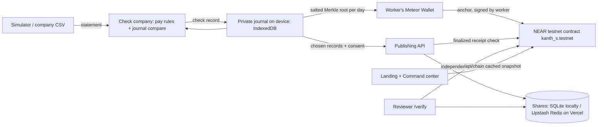

# Appeal: project report

_Status as of 14 November 2026. Repository: https://github.com/Lakshmikanth-3/Appeal_

## Summary

Appeal gives gig and informal workers proof of their own work. A worker keeps a private journal on their phone, saves a fingerprint of each day on NEAR testnet with their own wallet, checks company pay statements for underpayment, and shares only chosen records through an expiring link that anyone can verify against the blockchain.

| Item | Value |
|---|---|
| Contract | `kanth_s.testnet` (deployed and initialized, verified FINAL) |
| Deploy transaction | [`7QGcHbgghNQNVMeopydK43ukuFSjodXRZJnkhGAjKtMa`](https://testnet.nearblocks.io/txns/7QGcHbgghNQNVMeopydK43ukuFSjodXRZJnkhGAjKtMa) |
| Worker registration | [`4o2VD2AsdHHFBJf13YjrDyYgkAo1Lhkan6itM13PjDMt`](https://testnet.nearblocks.io/txns/4o2VD2AsdHHFBJf13YjrDyYgkAo1Lhkan6itM13PjDMt) (`lakshmi_kanth.testnet`) |
| Tracks | Privacy & Private AI (primary), Open Innovation |
| Hosted app | Vercel deployment prepared; see [Deployment](#deployment) |
| Tests | 180 unit tests, 2 project browser tests, 92 scripted UI checks: all passing |

## What a judge can try

| Page | What it does |
|---|---|
| `/` | Landing page with live testnet data: latest final block, registered workers, contract storage and balance, deployment links |
| `/app` | Worker app: Command center, Record, Journal, Check company, Prepare case, Backup |
| `/simulator` | DemoEats rider-app simulator: generates a GPS-routed shift, optionally underpays one trip |
| `/verify` | Reviewer page: checks a shared link or an uploaded pack against NEAR |

Two-minute demo path, no wallet needed: open `/simulator`, generate a shift with underpayment, click **Check in Appeal**. The flagged trip shows expected versus shown pay, the GPS distance gap, the missing incentive and the unexplained penalty, in English and Tamil.

Full path, needs a registered wallet: connect Meteor Wallet, record trips, **Save all days on NEAR**, prepare a case, open the reviewer link, see **Verified**; change any value in the downloaded pack and it fails.

## Architecture

- **Contract** (Rust, near-sdk): `new` (owner, network, capacities), `register_worker` (owner only), `anchor(v, network, worker, day, root, count)` (caller must be the worker; a day can only be re-anchored with more entries), `get_anchor`, `is_registered`, `get_config`. Only roots and counts are stored.
- **Browser**: plain ES modules, no framework. The wallet bundle (NEAR Wallet Selector + Meteor) is built with esbuild.
- **Server**: Node `http` handler. It runs as a normal server locally, in Docker or on Render, and as one Vercel function.
- **Live data**: `/api/chain` caches one chain read for 5 seconds. If the RPC rate-limits, it falls back to FastNEAR and backs off. If every read fails, it shows the last good reading labelled STALE.

## Spec coverage

This compares the requested spec with what is built. ✅ done and tested · 🟡 partly done or done differently · ❌ not done.

### 1. NEAR smart contract
| Requirement | Status | Notes |
|---|---|---|
| Rust near-sdk contract on testnet | ✅ | `kanth_s.testnet`, code hash matches the local build |
| Per-worker accounts | 🟡 | Workers use their own existing testnet accounts (registered by the owner), not sub-accounts of the app |
| Only the worker can anchor | ✅ | Predecessor must equal `worker`; 12 Rust host tests |
| `anchor_day` with trip, mismatch and shortfall counts | 🟡 | `anchor` stores root and entry count. Mismatch and shortfall are inside the day's records (check record), not separate on-chain fields |
| `get_anchor`, `list_anchors` | 🟡 | `get_anchor` yes; no `list_anchors` |
| `record_case` on-chain | ❌ | Cases are verified against day anchors; the case hash itself is not anchored |
| No raw data on-chain | ✅ | Only salted Merkle roots and counts |
| Deploy script with explorer links | ✅ | `npm run contract:deploy`, `npm run contract:register` |

### 2. Logger (worker app)
| Requirement | Status | Notes |
|---|---|---|
| Mobile-first installable PWA | ✅ | Service worker, manifest, bottom tab bar on phones |
| Next.js + Tailwind | 🟡 | Built without a framework (plain modules + CSS) |
| Easy login | 🟡 | Meteor Wallet with a limited function-call key scoped to `anchor`; no passkey or FastAuth |
| Trip fields: platform, amount, rating, note, screenshot, optional GPS point | ✅ | |
| Per-trip start/end time, GPS route, incentive and penalty fields in the logger | 🟡 | Captured in simulator and statement CSVs; the manual logger records one point and free text |
| "Captured live" timestamp | ✅ | Capture time recorded at tap; records marked `live-manual` or `company-check` |
| Raw data stays on device | ✅ | IndexedDB; screenshots and notes leave only in a pack the worker approves |

### 3. Pay-mismatch agent
| Requirement | Status | Notes |
|---|---|---|
| Expected pay from a per-platform rate card | ✅ | `lib/payrules.js`, `public/ratecards.json` |
| Threshold ₹5 or 5% | ✅ | |
| Distance gap, missing incentive, unexplained penalty | ✅ | |
| Severity low / medium / high | ✅ | |
| English and Tamil explanation | 🟡 | Rule-based templates, not an LLM. Labelled as rule-based in the UI |
| Rate card editable in the UI | ❌ | Edit `public/ratecards.json`; validated on load |
| LLM explanation via NEAR AI | 🟡 | NEAR AI private inference exists for case drafts (attested, opt-in, funded), but no paid run has been made |

### 4. Daily anchoring
| Requirement | Status | Notes |
|---|---|---|
| Hash records, Merkle tree, anchor per day | ✅ | "Save all days on NEAR", up to 20 days per wallet batch |
| Show transaction link | ✅ | |
| Verified after signing | ✅ | Final, successful receipt and exact arguments are checked before a day is marked saved |
| Real anchor executed on testnet | ❌ | Not yet done; it needs the worker's wallet approval |

### 5. Case builder
| Requirement | Status | Notes |
|---|---|---|
| Choose records, consent screen, expiring link | ✅ | 1 hour to 7 days; deletion capability |
| Earnings, penalties, deactivations summary | ✅ | Deterministic, recomputed by the reviewer |
| Merkle proof per included record | ✅ | |
| AI case summary | 🟡 | Optional NEAR AI draft with TEE verification; untested with a paid run |
| PDF download | 🟡 | JSON pack and printable review page; no generated PDF |

### 6. Verifier
| Requirement | Status | Notes |
|---|---|---|
| Open link or upload pack, no login | ✅ | |
| Recompute hashes, Merkle inclusion, on-chain root | ✅ | Plus worker signature, finalized receipt and trusted contract |
| Edited record fails verification | ✅ | Unit tests and browser checks; it shows "Not verified" for the pack, not which trip changed |

### 7. Simulator
| Requirement | Status | Notes |
|---|---|---|
| Fake delivery app with GPS routes and pay | ✅ | `/simulator`, fictional "DemoEats" |
| Inject underpayment | ✅ | Shorter app distance, dropped incentive, penalty without reason |

### 8. Support payout
❌ Not built. NEAR Intents has no testnet.

### Stack differences
The spec suggested Next.js, Fastify, Prisma and near-workspaces. The project uses plain browser modules, Node's `http`, SQLite (local) or Upstash Redis (Vercel), and near-sdk unit tests. Rebuilding with less than a day left would have meant replacing working, tested code.

## Testing

| Suite | Command | Result |
|---|---|---|
| Unit (proofs, adversarial RPC, signatures, reconciliation, sharing, Redis store, live status, readiness, statement comparison, pay rules) | `npm test` | 180 passed |
| Rust contract | `npm run contract:test` | 12 passed (last run 13 Nov) |
| Project browser tests | `npm run test:browser:portable` | 2 passed |
| Scripted UI checks, desktop 1440 px and mobile 390 px, live testnet | Playwright scripts (not committed) | 68 + 24 passed |

Covered by the UI checks:
- live block and worker count from the contract
- every page and its main buttons
- capture refused without a wallet
- company check and pay check, including the Tamil text
- a fair shift not flagged
- the reviewer rejecting forged and malformed packs
- no horizontal scroll, no JavaScript errors

Dashboard checks used test-only records in the browser, never written to NEAR.

Not tested automatically: wallet signing, a real anchor, publishing a real case end to end (needs a signed anchor), a paid AI run, and a real Android device.

## Deployment

The app is ready for Vercel:
- `vercel.json` routes every path through one function, so the security headers always apply.
- `.vercelignore` keeps `.env` and local data out of uploads.
- Shared links use Upstash Redis when `KV_REST_API_URL` and `KV_REST_API_TOKEN` are set. Without them, publishing is disabled with a clear message.

Status: **not yet deployed.** The Vercel CLI on this machine is not authenticated.

To finish:
1. Set `VERCEL_TOKEN` in `.env`, or run `npx vercel login`.
2. Deploy, setting `NEAR_NETWORK=testnet`, `ANCHOR_CONTRACT=kanth_s.testnet` and a production `PUBLISH_ACCESS_TOKEN`.
3. In the Vercel project, connect **Storage → Upstash for Redis**, then redeploy.

The URL is `<project-name>.vercel.app`. `appeal.vercel.app` is only possible if that name is free.

Docker and Render (`render.yaml`, persistent disk) remain supported.

## Honest list of what is unfinished

1. No worker evidence anchor has been executed on testnet yet. This is the core claim, and it needs the wallet owner's approval.
2. Hosted deployment is pending Vercel authentication and Upstash connection.
3. `record_case`, `list_anchors`, and per-day mismatch counts on-chain are not implemented.
4. Explanations are rule-based English/Tamil templates, not LLM output. The NEAR AI integration has not had a paid run, and the reviewer does not independently verify AI receipts.
5. No PDF export, no in-app rate-card editor, no support payout, no passkey login.
6. Demo rate cards (DemoEats, DemoRide) are illustrative, not any real platform's published rates.
7. Upstash's per-request size limit may reject packs with large screenshots. The app says so and suggests excluding screenshots or sharing the downloaded file.
8. The browser and reviewer confirm receipts only through `rpc.testnet.near.org`. Under rate limiting, a day stays pending until re-checked.
9. 16 low-severity upstream dependency audit findings remain.

## AI assistance and libraries

AI coding assistants wrote much of this code. The original prototype credited Claude; later work used Codex and Claude Code. That later work includes the live dashboard, landing page, company and pay checks, simulator, Vercel/Redis support and this report.

Runtime libraries: near-api-js, NEAR Wallet Selector (core, Meteor), NEAR AI inference SDK, buffer/process/util browser shims. Development tools: esbuild, Playwright. Contract: near-sdk (Rust). External services: NEAR testnet RPC (`rpc.testnet.near.org`, FastNEAR fallback for status), Meteor Wallet, Upstash Redis (hosted shares).

Evidence support, not legal advice.
